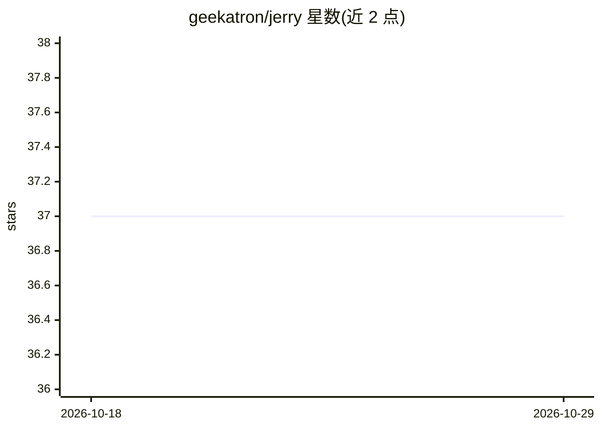

# geekatron/jerry

⭐ 37 · Python · NOASSERTION · 推送 2026-10-28 · [GitHub](https://github.com/geekatron/jerry) · [官网](https://jerry.geekatron.org) · 个人维护

**Claude Code 插件：为编码会话提供行为守则与知识沉淀**

运行于 Claude Code 内的插件，通过斜杠命令技能提供结构化问题求解、任务追踪与知识管理，包含 8 个专职 agent（researcher、analyst、architect 等）与多阶段工作流编排。核心机制是以持久化文件与文件系统记忆对抗'Context Rot'（上下文增长导致的模型性能退化），输出写入 docs/ 目录以在会话边界间留存。安装走本地 marketplace，macOS 为主要开发测试平台，Windows 支持仍在进行中；运行不需要本地 Python，仅贡献开发时需要 uv。

## 筛选速览

| 维度 | 判定 | 备注 |
|---|---|---|
| AI 角色 | `ai-ecosystem` | LLM/agent 周边工具 |
| 许可风险 | `permissive` | NOASSERTION |
| 部署形态 | `None` |  |
| 模型依赖 | locked-api |  |
| 硬件要求 | — | 无带数字的原话,不猜 |
| 安装摩擦 | `low` | 无编译、无系统依赖或容器化 |
| 成熟度 | — | 结构信号不足 |

## 能力要点

- 8 个专职 agent 与多 agent 编排（含 checkpoint）
- 输出持久化到文件，跨会话构建项目知识库
- 6 个斜杠命令技能（问题求解/任务追踪/NASA 系统工程等）
- 基于文件系统记忆对抗 Context Rot

## 适用场景

- 在 Claude Code 中做结构化问题求解与根因分析
- 用持久化工件管理任务与项目知识，避免上下文丢失后重复劳动
- 按 NPR 7123.1D 流程做系统工程与架构决策记录

## 场景标签

`多智能体` `编码 Agent` `知识库管理` · 领域:Agent 开发

## 证据(README 行号)

> L3: > A Claude Code plugin for behavior and workflow guardrails with knowledge accrual.
> L10: Jerry is a **Claude Code plugin** that adds structured problem-solving capabilities, work tracking, and knowledge m

## 星数曲线

2026-10-18 37 → 2026-10-29 37（+0）

---
*卡片 v1 · prompt 1.4 · 生成 2026-10-25 · 置信度 high · 依据 README sha `dcf87c1b6fb6` · [字段定义](../../DATASET.md)*
