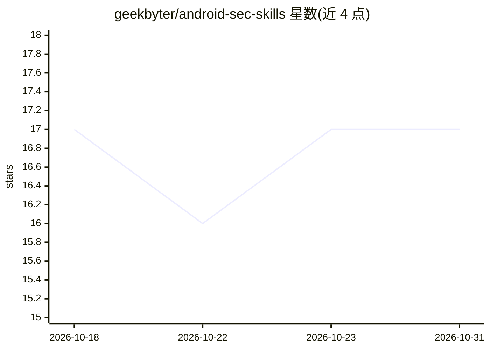

# geekbyter/android-sec-skills

⭐ 17 · 推送 2026-05-14 · [GitHub](https://github.com/geekbyter/android-sec-skills) · 个人维护 · 中文 README

**指导 Codex 做授权 Android 应用安全审计的技能（skill）**

面向 Codex agent 的 Android 安全研究技能包：通过本地搭建一个名为 StandUp 的参考项目，引导模型以借鉴名义对指定 App 做逆向分析并还原防护代码，输出 detected/suspicious_only/unsupported 三级证据判定；依赖 jadx-mcp、ida-pro-mcp、Binary Ninja MCP 环境，支持 adb 运行态证据采集。仅声明在 Codex 上可用，其他环境未测试；明确限定用于第一方、授权范围内的研究与加固，不用于绕过第三方防护或未授权攻击。

## 筛选速览

| 维度 | 判定 | 备注 |
|---|---|---|
| AI 角色 | `ai-ecosystem` | LLM/agent 周边工具 |
| 许可风险 | `none` | — |
| 部署形态 | `None` |  |
| 模型依赖 | — | README 未给出锁定关系 |
| 硬件要求 | — | 无带数字的原话,不猜 |
| 安装摩擦 | `medium` | 含编译或系统依赖之一 |
| 成熟度 | — | 结构信号不足 |

## 能力要点

- 三档证据分级：detected / suspicious_only / unsupported
- 需自行配置 jadx-mcp、ida-pro-mcp、Binary Ninja MCP 环境
- 通过本地参考项目引导模型产出防护代码与检测思路
- 强调 adb shell / root shell / App UID 三种证据视角的区分

## 适用场景

- 审计或加固自己拥有的 Android App
- 让 Codex 分析 APK / native so 的运行态证据
- 提取可靠检测思路并移植到现有 App

## 场景标签

`网络安全` · 领域:学习与行业

## 证据(README 行号)

> L5: 主要是本地创建一个安卓项目，这里我的项目叫【StandUp】，让gpt以借鉴的名义来逆向分析你指定的app并还原对应的防护代码；你再拿着防护代码对抗分析或者自实现，算是另一种层面的绕过机制
> L29: 在任务里用【$】调起skils技能列表然后选 `android-security-researcher` 即可， 或提出类似下面的需求时，Codex 应主动加载这个 skill：
> L31: ```text

## 星数曲线



2026-10-18 17 → 2026-10-31 17（+0）


---
*卡片 v1 · prompt 1.4 · 生成 2026-10-29 · 置信度 mid · 依据 README sha `1a3a36f305b6` · [字段定义](../../DATASET.md)*
