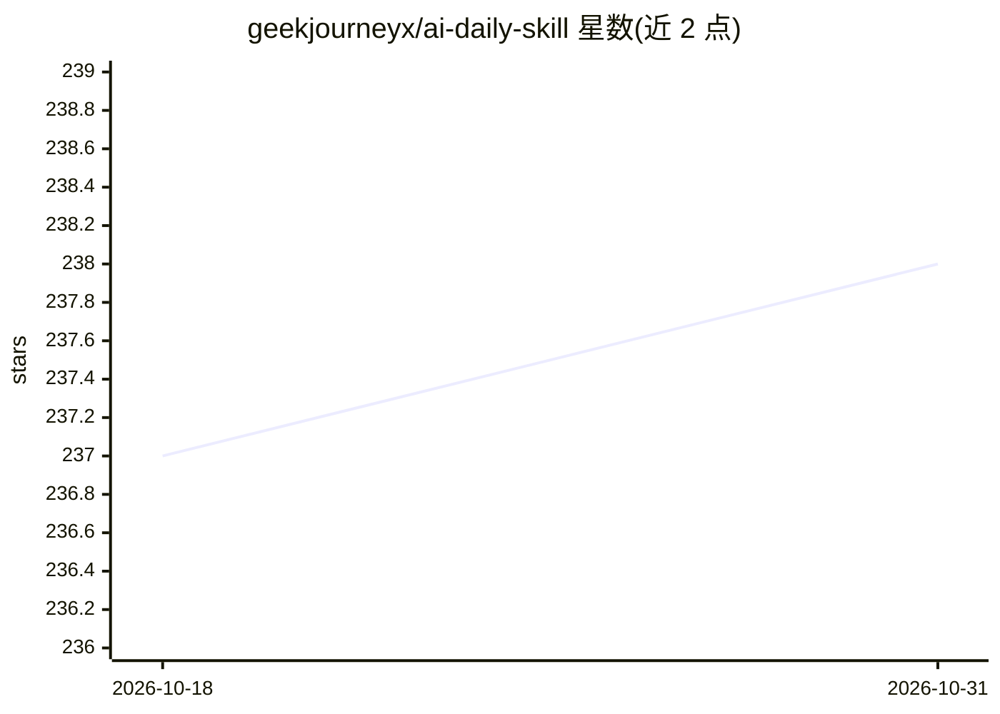

# geekjourneyx/ai-daily-skill

⭐ 238 · Python · 推送 2026-10-30 · [GitHub](https://github.com/geekjourneyx/ai-daily-skill) · [官网](https://geekjourney.dev) · 个人维护 · 中文 README

**在 Claude Code 中获取并归类 AI 资讯日报的 Skill**

一个 Claude Code Skill/插件：从 smol.ai 获取 AI 行业资讯，调用 Claude Code 内置 AI 能力生成摘要与分类的结构化 Markdown 日报，支持相对/绝对日期查询，可按需生成单文件 HTML 网页（三种主题）、社交媒体分享卡片和小红书风格封面。无需额外 API Key；图片生成需设置环境变量并配置 Firefly API。提供插件市场安装、源码克隆与全局复制三种安装方式，MIT 协议。

## 筛选速览

| 维度 | 判定 | 备注 |
|---|---|---|
| AI 角色 | `ai-native` | 本体是模型或模型工具 |
| 许可风险 | `none` | — |
| 部署形态 | `library` | 以包/库形式分发 |
| 模型依赖 | — | README 未给出锁定关系 |
| 硬件要求 | — | 无带数字的原话,不猜 |
| 安装摩擦 | `low` | 无编译、无系统依赖或容器化 |
| 成熟度 | — | 结构信号不足 |

## 能力要点

- 每天从 smol.ai 获取 AI 资讯并用 Claude 生成摘要与分类
- 生成 Markdown 日报与三种主题的单文件 HTML 网页
- 可选生成分享卡片图片与小红书风格封面（需 Firefly API）
- 使用 Claude Code 内置 AI 能力，无需额外配置 API Key

## 适用场景

- 在 Claude Code 里按日期查询 AI 行业资讯摘要
- 把 AI 日报生成网页或分享卡片发布到社交媒体
- 制作小红书风格的日报封面图

## 场景标签

`AI 写作` `图像生成` · 领域:内容生成

## 证据(README 行号)

> L3: > AI 资讯日报 Claude Code Skill - 每天自动获取、分析、归类 AI 前沿资讯
> L10: AI Daily 是一个 Claude Code Skill，帮助你在 Claude Code 中快速获取 AI 行业资讯。它从 smol.ai 获取资讯，使用内置的 Claude AI 能力进行智能分析和分类，生成结构化的 Ma
> L15: - Claude AI 智能摘要和分类

## 星数曲线

2026-10-18 237 → 2026-10-31 238（+1）

---
*卡片 v1 · prompt 1.4 · 生成 2026-10-22 · 置信度 mid · 依据 README sha `762266ea2a41` · [字段定义](../../DATASET.md)*
