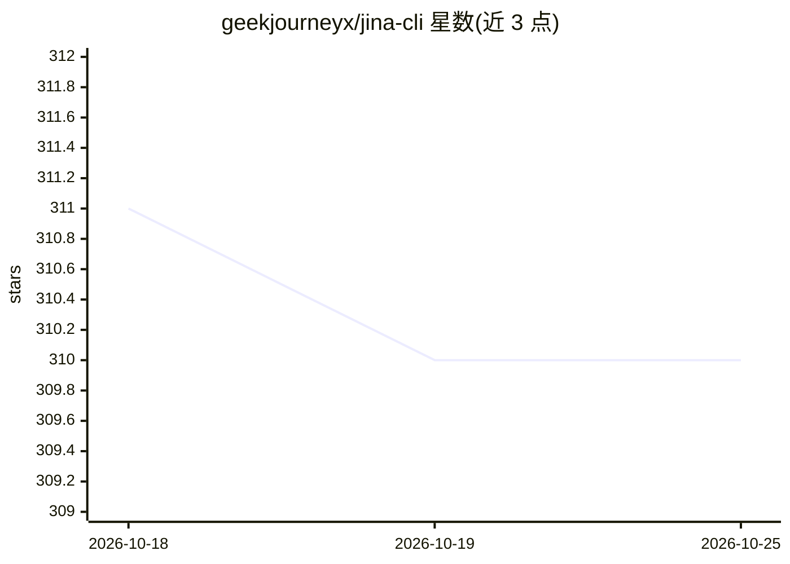

# geekjourneyx/jina-cli

⭐ 311 · Go · MIT · 推送 2026-03-01 · [GitHub](https://github.com/geekjourneyx/jina-cli) · 个人维护 · 中文 README

**封装 Jina AI Reader API 的网页转 Markdown CLI，供 AI Agent 调用**

用 Go 编写的轻量命令行工具，封装 Jina AI Reader（r.jina.ai）与 Search（s.jina.ai）API，将任意 URL 转换为 LLM 友好的 Markdown/Text/HTML 或 JSON 输出，支持批量处理、CSS 选择器提取、SPA 处理、代理、Cookie 与缓存控制。面向 AI Agent 使用者与开发者，提供三种独立安装方式：OpenClaw Skill、Claude Code Skill 和 CLI 二进制（一键脚本/手动下载/源码构建，Linux/macOS amd64/arm64）。限制：依赖 Jina AI 在线 API，可选 API Key 提升速率限制。

## 筛选速览

| 维度 | 判定 | 备注 |
|---|---|---|
| AI 角色 | `ai-ecosystem` | LLM/agent 周边工具 |
| 许可风险 | `permissive` | MIT |
| 部署形态 | `library` | 以包/库形式分发 |
| 模型依赖 | — | README 未给出锁定关系 |
| 硬件要求 | — | 无带数字的原话,不猜 |
| 安装摩擦 | `low` | 无编译、无系统依赖或容器化 |
| 成熟度 | — | 结构信号不足 |

## 能力要点

- read/search 两命令，输出 Markdown/Text/HTML/JSON
- 三种独立安装方式：OpenClaw Skill、Claude Code Skill、CLI 二进制
- 批量 URL 处理与配置文件/环境变量/命令行三级配置
- CSS 选择器提取、SPA POST 模式、代理与 Cookie 支持

## 适用场景

- 在 Claude Code 或本地 AI 助理中让 Agent 读取网页并转为 LLM 输入
- 批量抓取 URL 列表转为 Markdown 供后续处理
- 脚本中调用网络搜索并获取结构化结果

## 场景标签

`网页抓取` · 领域:效率与自动化

## 证据(README 行号)

> L16: `jina` 是一个轻量级的命令行工具，封装了 Jina AI Reader API，可以将任意 URL 转换为 LLM 友好的输入格式。特别适合阅读 X (Twitter)、博客、新闻网站等复杂网页。
> L282: ### 与 AI Agent 集成

## 星数曲线

2026-10-18 311 → 2026-10-25 310（-1）

---
*卡片 v1 · prompt 1.4 · 生成 2026-10-21 · 置信度 high · 依据 README sha `ba22978b532e` · [字段定义](../../DATASET.md)*
