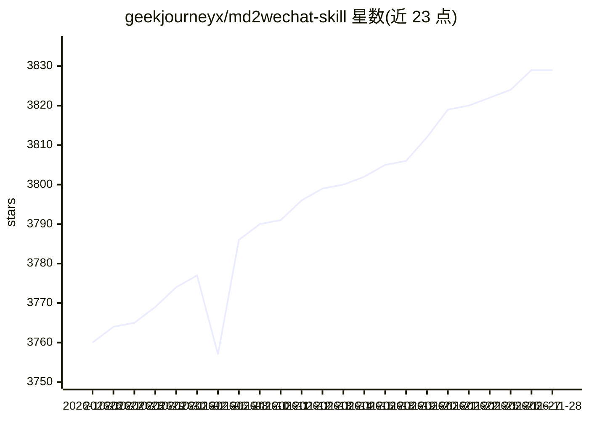

# geekjourneyx/md2wechat-skill

⭐ 3,829 · Go · NOASSERTION · 推送 2026-11-27 · [GitHub](https://github.com/geekjourneyx/md2wechat-skill) · [官网](https://md2wechat.cn) · 个人维护 · 中文 README

**给 AI Agent 用的微信公众号排版与发布 CLI**

md2wechat 把公众号发布流程拆为一组 CLI 命令：Markdown 转微信 HTML、发布前 readiness 检查、`:::module` 高级排版语法、封面/信息图生成、文章与标题撰写，以及通过宿主 Agent 操作已登录浏览器写入知乎、CSDN、头条、腾讯云开发者社区草稿。通过 JSON discovery 供 Claude Code、Codex 等本地 Agent 调用。预览与转换的 API 模式为付费服务，需要 API Key；免费 AI 模式仅生成 prompt 交由外部 LLM 处理；商业使用需商业授权。

## 筛选速览

| 维度 | 判定 | 备注 |
|---|---|---|
| AI 角色 | `ai-native` | 本体是模型或模型工具 |
| 许可风险 | `none` | NOASSERTION |
| 部署形态 | `library` | 以包/库形式分发 |
| 模型依赖 | locked-api |  |
| 硬件要求 | — | 无带数字的原话,不猜 |
| 安装摩擦 | `low` | 无编译、无系统依赖或容器化 |
| 成熟度 | — | 结构信号不足 |

## 能力要点

- 提供 capabilities/doctor/inspect 等 JSON discovery 命令供 Agent 调用
- API 模式含 48 个专业主题与 59 个主推 :::module 排版语法
- 支持封面与信息图生成，接入 Volcengine、ModelScope、OpenRouter、OpenAI、Gemini、MiniMax 等图片服务
- 多平台草稿：由宿主 Agent 按内置步骤操作浏览器写入知乎/CSDN/头条草稿

## 适用场景

- 写完 Markdown 后排版并推送到公众号草稿箱
- 让 Claude Code 等 Agent 自动完成公众号创作与发布流程
- 为公众号文章批量生成封面图和信息图
- 一次准备正文后同步到知乎、CSDN、头条等多个平台草稿

## 场景标签

`AI 写作` `图像生成` `浏览器自动化` · 领域:效率与自动化

## 证据(README 行号)

> L4: **面向 AI Agent 的微信公众号创作与发布 CLI**
> L6: 写 Markdown，生成公众号排版，制作封面和文章配图，预览校验后推送草稿箱。
> L10: 支持 Claude Code、Codex、WorkBuddy、Kimi Work、Hermes Agent、OpenClaw 等 Agent 通过 JSON discovery 稳定调用。

## 星数曲线

2026-10-26 3,760 → 2026-11-28 3,829（+69）

---
*卡片 v1 · prompt 1.4 · 生成 2026-11-28 · 置信度 high · 依据 README sha `563d39cb6b6c` · [字段定义](../../DATASET.md)*
