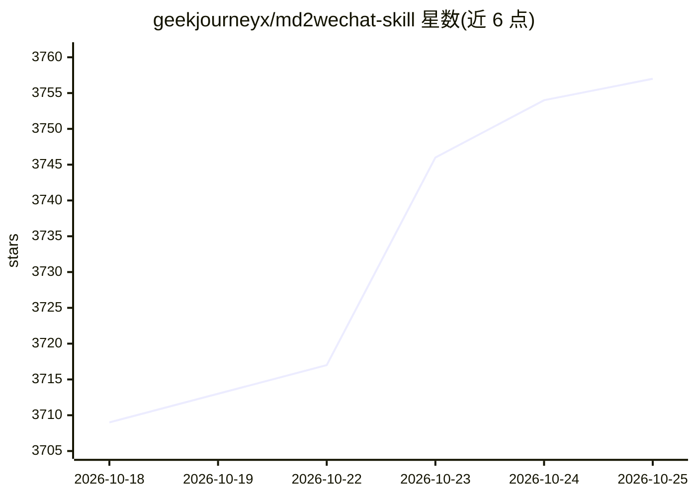

# geekjourneyx/md2wechat-skill

⭐ 3,757 · Go · NOASSERTION · 推送 2026-10-14 · [GitHub](https://github.com/geekjourneyx/md2wechat-skill) · [官网](https://md2wechat.cn) · 个人维护 · 中文 README

**面向 AI Agent 的微信公众号排版与发布 CLI**

Go 编写、npm 分发的命令行工具，供 Claude Code、Codex、Kimi Work 等 Agent 通过 JSON discovery 调用，完成 Markdown 转微信公众号 HTML、发布前检查（inspect）、预览、上传图片与创建草稿。支持 write/humanize/title suggest 等内容命令及封面、信息图生成（可接 Volcengine、OpenRouter、OpenAI、MiniMax 等图片服务）；v3.6.0 起可由宿主 Agent 操作已登录浏览器写入知乎、CSDN、头条等平台草稿。稳定转换与高级排版依赖付费专业 API（48 主题、59 个 ::: 语法）；免费 AI 模式仅生成交给外部 LLM 的 prompt。采用 Source Available License，商业使用需另行授权。

## 筛选速览

| 维度 | 判定 | 备注 |
|---|---|---|
| AI 角色 | `ai-ecosystem` | LLM/agent 周边工具 |
| 许可风险 | `none` | NOASSERTION |
| 部署形态 | `library` | 以包/库形式分发 |
| 模型依赖 | — | README 未给出锁定关系 |
| 硬件要求 | — | 无带数字的原话,不猜 |
| 安装摩擦 | `low` | 无编译、无系统依赖或容器化 |
| 成熟度 | — | 结构信号不足 |

## 能力要点

- Markdown 转微信 HTML，inspect/preview/convert 命令边界固定、JSON discovery 供 Agent 机读
- 多平台草稿：sync prepare 后由宿主 Agent 操作已登录浏览器写入知乎、CSDN、头条草稿
- 封面与信息图生成，支持 Volcengine、ModelScope、OpenRouter、OpenAI、Gemini、MiniMax 等图片 provider，或复用宿主 Image Gen
- 稳定转换与 59 个高级排版 ::: 语法依赖付费专业 API；免费模式生成 prompt 交外部 LLM

## 适用场景

- 我用 Agent 写作后，把 Markdown 排成公众号格式并推送草稿箱
- 发布前用 inspect 检查标题、图片、封面和 readiness
- 让 Agent 把同一篇文章准备成知乎、CSDN、头条等多平台草稿

## 场景标签

`AI 写作` `图像生成` · 领域:内容生成

## 证据(README 行号)

> L10: 支持 Claude Code、Codex、WorkBuddy、Kimi Work、Hermes Agent、OpenClaw 等 Agent 通过 JSON discovery 稳定调用。
> L141: md2wechat 给 Agent 提供可机读接口，减少猜测和误操作。
> L152: 文章命令边界固定为：`inspect` 返回结构化 metadata、checks、readiness targets 和 blockers；`preview` 只把成功的 API converter 最终 HTML 原样写入文

## 星数曲线

2026-10-18 3,709 → 2026-10-25 3,757（+48）

---
*卡片 v1 · prompt 1.4 · 生成 2026-10-21 · 置信度 high · 依据 README sha `9a0770bbf448` · [字段定义](../../DATASET.md)*
