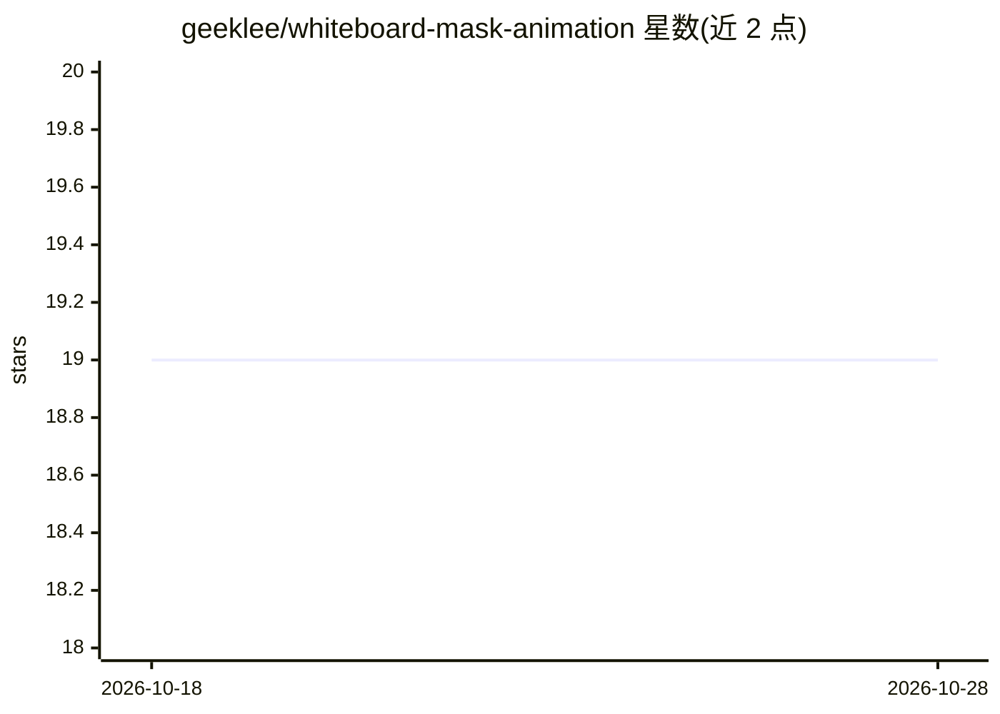

# geeklee/whiteboard-mask-animation

⭐ 19 · HTML · MIT · 推送 2026-07-26 · [GitHub](https://github.com/geeklee/whiteboard-mask-animation) · 个人维护 · 中文 README

**把静态线稿做成白板手绘遮罩动画的 Agent Skill**

面向 Agent 的技能包（含 SKILL.md、Python 脚本与手部素材）：从中文文章或分镜拆解配图策略，生成 16:9 暖米黄线稿源图与像素级 annotation.json 标注，按叙事顺序用遮罩逐个揭示区域，手部笔尖沿遮罩边缘移动，支持保护区防止重叠内容提前露出。提供本地预览台（播放、拖时间轴、编辑区域），用户确认后渲染导出 MP4。可放入 Agent Skills 目录或在 Codex 中引用。

## 筛选速览

| 维度 | 判定 | 备注 |
|---|---|---|
| AI 角色 | `ai-ecosystem` | LLM/agent 周边工具 |
| 许可风险 | `permissive` | MIT |
| 部署形态 | `library` | 以包/库形式分发 |
| 模型依赖 | — | README 未给出锁定关系 |
| 硬件要求 | — | 无带数字的原话,不猜 |
| 安装摩擦 | `low` | 无编译、无系统依赖或容器化 |
| 成熟度 | — | 结构信号不足 |

## 能力要点

- 按叙事顺序（场景铺垫→人物→动作→反应）控制元素揭示顺序
- 像素级 annotation.json 标注，含方向、时序与手部轨迹
- 本地预览台支持播放、时间轴拖动与区域编辑
- 保护区机制避免重叠对象提前露出

## 适用场景

- 把文章配图或分镜线稿做成口播讲解视频
- 知识讲解、故事分镜的动画化呈现
- 在预览台中调整动画时序后导出 MP4

## 场景标签

`视频生成` · 领域:内容生成

## 证据(README 行号)

> L37: 将此目录放入你的 Agent Skills 目录，或在 Codex 中直接引用 `whiteboard-mask-animation`。
> L106: ├── SKILL.md                          # Agent 使用说明与完整规范

## 星数曲线

2026-10-18 19 → 2026-10-28 19（+0）

---
*卡片 v1 · prompt 1.4 · 生成 2026-10-28 · 置信度 low · 依据 README sha `d6191033b9c3` · [字段定义](../../DATASET.md)*
