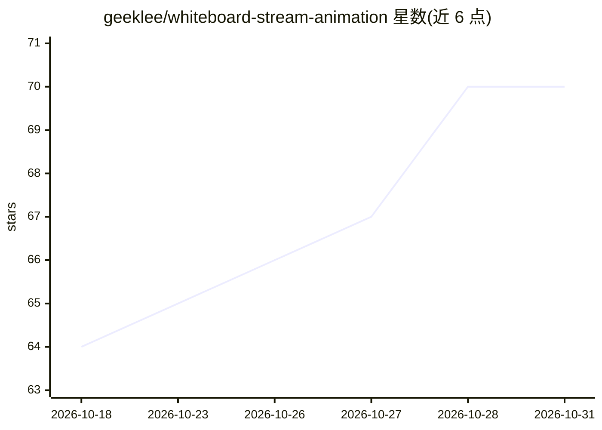

# geeklee/whiteboard-stream-animation

⭐ 70 · Python · MIT · 推送 2026-07-26 · [GitHub](https://github.com/geeklee/whiteboard-stream-animation) · 个人维护 · 中文 README

**把插图渲染为白板手绘动画并导出 H.264 MP4 的 Skill**

以 Python 脚本和 SKILL.md 形式提供的白板动画渲染工具：输入一张插图（PNG/JPG/BMP/TIFF），按起笔线稿、添彩回填、凝视停留三段式节奏生成手绘动画，通过 PyAV 输出 H.264 MP4（安装 FFmpeg 后处理更灵活）；支持多图队列渲染与 --merge 合并为完整视频。附带的 Skill 工作流约束 Agent 在无源图时先拆分场景、输出配图策略并等待用户确认。通过 git clone 与 prepare_env.py 脚本安装。

## 筛选速览

| 维度 | 判定 | 备注 |
|---|---|---|
| AI 角色 | `ai-enhanced` | 去掉 AI 部分产品仍成立 |
| 许可风险 | `permissive` | MIT |
| 部署形态 | `None` |  |
| 模型依赖 | — | README 未给出锁定关系 |
| 硬件要求 | — | 无带数字的原话,不猜 |
| 安装摩擦 | `medium` | 含编译或系统依赖之一 |
| 成熟度 | — | 结构信号不足 |

## 能力要点

- 三段式动画节奏（线稿→回填→停留）与连续笔尖轨迹
- 两种笔迹路径（grid/skeleton）与两种上色方式（contour-wipe/brush）
- 批量队列渲染并按顺序合并为一条 H.264 视频
- 默认经 PyAV 输出，不依赖系统级 FFmpeg

## 适用场景

- 把绘本或课程配图做成讲解动画视频
- 按口播稿拆分场景后批量生成并合并成片
- 为短视频制作手绘白板风格素材

## 场景标签

`视频生成` · 领域:内容生成

## 证据(README 行号)

> L3: 把一张插图渲染为连续落笔、逐步上色、最后停留展示的白板手绘动画，并导出 H.264 MP4。适合故事绘本、知识讲解、课程配图和短视频素材。
> L137: ├── SKILL.md              # 面向 Agent 的工作流与约束

## 星数曲线

2026-10-18 64 → 2026-10-31 70（+6）

---
*卡片 v1 · prompt 1.4 · 生成 2026-10-24 · 置信度 high · 依据 README sha `004e581b871e` · [字段定义](../../DATASET.md)*
