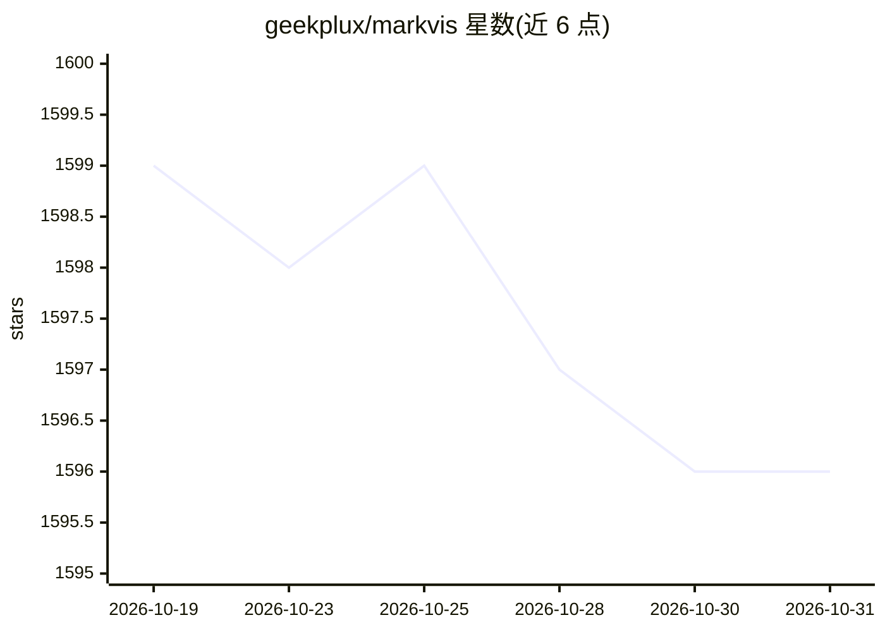

# geekplux/markvis

⭐ 1,596 · TypeScript · MIT · 推送 2026-10-26 · [GitHub](https://github.com/geekplux/markvis) · [官网](https://markvis.js.org/) · 个人维护

**在 Markdown 中以文本块绘制图表的渲染库**

以 Markdown 代码块（```chart）承载图表数据的渲染库：块内为纯文本行数据，在网页、笔记、文档站等处渲染为 SVG 图表；无法绘制时保留为普通表格并给出稳定错误码。提供 script 标签、JS/React API、markdown-it/remark/rehype 插件与 GitHub Actions 集成，支持 17 种图表类型、7 种主题，0 依赖、58 kB gzip。面向写文档的开发者，同时提供 250 token 的模型指令与 llms.txt，使 LLM 可直接输出该图表格式。CLI 支持 bake 生成图片供 GitHub 展示、check 校验块有效性。

## 筛选速览

| 维度 | 判定 | 备注 |
|---|---|---|
| AI 角色 | `ai-ecosystem` | LLM/agent 周边工具 |
| 许可风险 | `permissive` | MIT |
| 部署形态 | `library` | 以包/库形式分发 |
| 模型依赖 | — | README 未给出锁定关系 |
| 硬件要求 | — | 无带数字的原话,不猜 |
| 安装摩擦 | `low` | 无编译、无系统依赖或容器化 |
| 成熟度 | — | 结构信号不足 |

## 能力要点

- 17 种图表类型，纯 SVG 输出，0 依赖、58 kB gzip
- 无法绘制时保留数据表格并输出稳定错误码，数据不丢失
- 提供 markdown-it/remark/rehype 插件与 GitHub Actions 工作流
- 250 token 模型指令与 llms.txt，支持 LLM 直接写出图表块

## 适用场景

- 在文档站或笔记中用文本块嵌入可维护的图表
- 让 LLM 在对话或系统提示下直接输出图表块而非图片/JSON
- 通过 CI 在每次 push 时为 README 生成图表图片供 GitHub 展示

## 场景标签

 · 领域:数据可视化/前端

## 证据(README 行号)

> L48: **Tell your model.** Put the 250-token instruction in a system prompt and it writes this block instead of an image 
> L58: - **Models write it from a short instruction.** A 250-token model instruction for a system prompt; the same text op
> L102: With an AI: put docs/prompt.md in the system prompt, or point a model at llms.txt or skills/markvis/SKILL.md. It s

## 星数曲线



2026-10-19 1,599 → 2026-10-31 1,596（-3）


---
*卡片 v1 · prompt 1.4 · 生成 2026-10-21 · 置信度 mid · 依据 README sha `4c877af5d865` · [字段定义](../../DATASET.md)*
