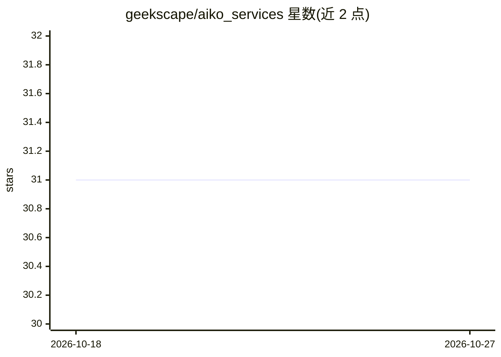

# geekscape/aiko_services

⭐ 31 · Python · Apache-2.0 · 推送 2026-10-23 · [GitHub](https://github.com/geekscape/aiko_services) · 个人维护

**反射式分布式计算框架：面向 AI、机器人与 AIoT 的消息服务**

Aiko Services 是一个 Python 分布式服务框架，基于 Actor 模型与消息传递实现全异步方法调用，通过 Flow 编程的 Pipeline 与 PipelineElement 组合组件。支持从嵌入式设备（ESP32 + microPython 参考实现）到数据中心的跨节点机器学习流式管线，提供 Aiko Dashboard 可视化诊断。消息层使用 MQTT，可用公共服务器或自建 mosquitto。示例覆盖语音转录、LLM、目标检测、机器人等场景，可从 PyPI 或 GitHub 源码安装。

## 筛选速览

| 维度 | 判定 | 备注 |
|---|---|---|
| AI 角色 | `ai-ecosystem` | LLM/agent 周边工具 |
| 许可风险 | `permissive` | Apache-2.0 |
| 部署形态 | `library` | 以包/库形式分发 |
| 模型依赖 | — | README 未给出锁定关系 |
| 硬件要求 | — | 无带数字的原话,不猜 |
| 安装摩擦 | `low` | 无编译、无系统依赖或容器化 |
| 成熟度 | — | 结构信号不足 |

## 能力要点

- Actor 模型 + 消息传递的全异步分布式方法调用
- Pipeline/PipelineElement 流式编程，支持跨进程跨主机部署
- 可运行于嵌入式设备（ESP32 + microPython 参考实现）
- Aiko Dashboard 可视化诊断与 MQTT 通信（可选自建 mosquitto）

## 适用场景

- 构建跨边缘设备与服务器的机器学习流式管线
- 通过分布式 Actor 服务组合语音、LLM、目标检测等能力
- 用 Aiko Dashboard 观察与诊断多组件互联系统

## 场景标签

 · 领域:分布式计算/机器人/ML 应用框架

## 证据(README 行号)

> L12: Aiko Services is a reflective distributed computing framework for systems that
> L23: - Supports multi-nodal Machine Learning streaming pipelines ... that span from edge (embedded) devices all the way 
> L28:  - Uses Flow based programming via distributed Pipelines and PipelineElements

## 星数曲线

2026-10-18 31 → 2026-10-27 31（+0）

---
*卡片 v1 · prompt 1.4 · 生成 2026-10-26 · 置信度 high · 依据 README sha `6229a55320ef` · [字段定义](../../DATASET.md)*
