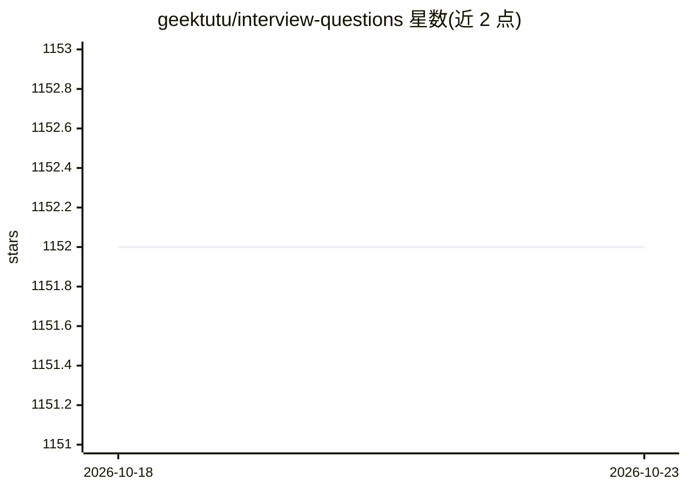

# geektutu/interview-questions

⭐ 1,152 · Jupyter Notebook · 推送 2026-09-05 · [GitHub](https://github.com/geektutu/interview-questions) · [官网](https://geektutu.com/post/qa-ml.html) · 个人维护 · 中文 README

**机器学习/深度学习/Python/Go 面试笔试题整理仓库**

个人持续整理的面试笔试题合集，以 Markdown 文件分批组织，覆盖机器学习、深度学习与 Python 领域的选择题与问答题，并附答案与解析（如决策树连续特征划分、过拟合与欠拟合、K 折交叉验证）。另设 Go 语言笔试题（基础语法、实现原理、并发编程、代码输出）系列。题目来源包括 CMU 考题与 Andrew Ng 的 coursera 课程。声明禁止未经许可原文转载。

## 筛选速览

| 维度 | 判定 | 备注 |
|---|---|---|
| AI 角色 | `ai-knowledge` | 知识聚合/清单类 |
| 许可风险 | `none` | — |
| 部署形态 | `None` |  |
| 模型依赖 | — | README 未给出锁定关系 |
| 硬件要求 | — | 无带数字的原话,不猜 |
| 安装摩擦 | `low` | 无编译、无系统依赖或容器化 |
| 成熟度 | — | 结构信号不足 |

## 能力要点

- 机器学习/深度学习面试题按批次（01-10、11-20 等）组织为 Markdown 文件
- 含选择题与问答题并附答案解析
- Go 语言笔试题分基础语法、实现原理、并发编程、代码输出四类
- 题目来源标注 CMU 考题与 Andrew Ng coursera 课程

## 适用场景

- 准备机器学习/深度学习方向的技术面试与笔试
- 复习 Go 语言语法与实现原理知识点
- 通过带答案的题目自查机器学习基础概念

## 场景标签

`教程课程` · 领域:学习与行业

## 证据(README 行号)

> L5: 持续整理、更新Python、机器学习(Machine Learning)、深度学习(Deep Learning)领域的面试笔试题(interview questions)。
> L13: - 机器学习面试题 01-10，md

## 星数曲线

2026-10-18 1,152 → 2026-10-23 1,152（+0）

---
*卡片 v1 · prompt 1.4 · 生成 2026-10-21 · 置信度 high · 依据 README sha `fd7b22d96193` · [字段定义](../../DATASET.md)*
