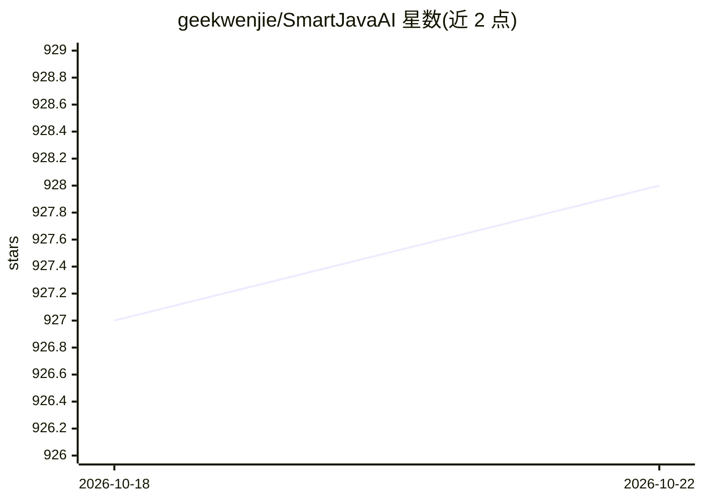

# geekwenjie/SmartJavaAI

⭐ 928 · Java · NOASSERTION · 推送 2026-06-20 · [GitHub](https://github.com/geekwenjie/SmartJavaAI) · [官网](http://smartjavaai.cn) · 个人维护 · 中文 README

**面向 Java 开发者的离线 AI 算法工具箱：人脸/检测/OCR/语音开箱即用**

基于 Maven 引用的 Java 离线 AI 算法工具包，底层用 DJL 封装深度学习模型并以 JNI 接入 C++/Python 算法，兼容 PyTorch、TensorFlow、ONNX、Paddle 等引擎。功能覆盖人脸检测/识别/活体/属性/质量评估、目标检测、分割、OCR（含车牌/表格/身份证）、机器翻译（NLLB-200）、语音识别（Whisper/vosk/sherpa-onnx）与 TTS、CLIP 图文检索等，按 face/vision/ocr/translate/speech 模块单独引入。跨 Windows/Linux/macOS（x86_64 与 ARM64）。另有 Android 商业授权 SDK 版本。

## 筛选速览

| 维度 | 判定 | 备注 |
|---|---|---|
| AI 角色 | `ai-native` | 本体是模型或模型工具 |
| 许可风险 | `none` | NOASSERTION |
| 部署形态 | `None` |  |
| 模型依赖 | — | README 未给出锁定关系 |
| 硬件要求 | — | 无带数字的原话,不猜 |
| 安装摩擦 | `medium` | 含编译或系统依赖之一 |
| 成熟度 | — | 结构信号不足 |

## 能力要点

- 人脸全链路：检测、1:1/1:N 比对、活体、属性、质量评估，人脸库支持 milvus/sqlite
- 集成 YOLOv5~v12 系列目标检测、分割、姿态估计与零样本检测模型
- OCR 覆盖 PaddleOCR PP-OCRv5、表格、12 种中文车牌、身份证正反面
- ASR/TTS 集成 Whisper、vosk、sherpa-onnx；翻译集成 NLLB-200（200+语言）

## 适用场景

- 在 Java 业务系统中直接调用人脸识别或活体检测，无需 Python 环境
- Java 项目集成 OCR、车牌识别、身份证识别等文档处理能力
- 离线场景下做目标检测、行人检测或视频流分析
- 构建本地人脸库并做 1:N 搜索

## 场景标签

`人脸识别` `目标检测` `OCR` `语音识别` · 领域:感知与多模态

## 证据(README 行号)

> L29: SmartJavaAI是专为JAVA 开发者打造的一个功能丰富、开箱即用的 JAVA AI算法工具包，致力于帮助JAVA开发者零门槛使用各种AI算法模型，开发者无需深入了解底层实现，即可轻松在 Java 代码中调用人脸识别、目标检
> L157: - **人脸识别**

## 星数曲线

2026-10-18 927 → 2026-10-22 928（+1）

---
*卡片 v1 · prompt 1.4 · 生成 2026-10-21 · 置信度 high · 依据 README sha `b48910d0ef7a` · [字段定义](../../DATASET.md)*
