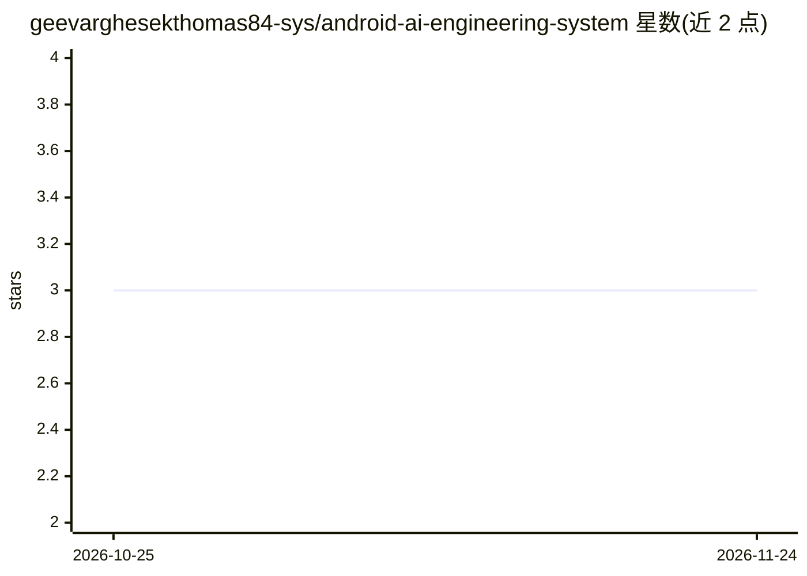

# geevarghesekthomas84-sys/android-ai-engineering-system

⭐ 3 · PowerShell · MIT · 推送 2026-10-23 · [GitHub](https://github.com/geevarghesekthomas84-sys/android-ai-engineering-system) · [官网](https://geevarghesekthomas84-sys.github.io/android-ai-engineering-system/) · 个人维护

**面向 Claude Code 的 14 个 Android 全栈开发 AI 技能集**

一组面向 Claude Code 及兼容 AI 助手的工程技能文件集合，共 14 个，覆盖 UI/UX、前端、后端、测试、安全、DevOps、AI 集成、架构等领域；每个技能由 SKILL.md 入口与 references 参考库组成，加载后使 AI 按对应角色输出指导与代码模式。提供 PowerShell 安装脚本将技能部署到 Claude Code、Gemini CLI 或 Codex，并附带 Android + NestJS + PostgreSQL + Redis 的全栈示例应用及其测试结果。

## 筛选速览

| 维度 | 判定 | 备注 |
|---|---|---|
| AI 角色 | `ai-knowledge` | 知识聚合/清单类 |
| 许可风险 | `permissive` | MIT |
| 部署形态 | `self-host` | docker 或自建部署 |
| 模型依赖 | locked-api |  |
| 硬件要求 | — | 无带数字的原话,不猜 |
| 安装摩擦 | `low` | 无编译、无系统依赖或容器化 |
| 成熟度 | — | 结构信号不足 |

## 能力要点

- 14 个领域技能，每个含 SKILL.md 入口、角色定义与决策框架
- 安装脚本可部署到 Claude Code、Gemini CLI 或 Codex
- 附带含端到端 CRUD 的全栈示例应用（13 个 Jest 集成测试、3 个 JUnit 单测）
- CI 覆盖技能校验、安全扫描、文档 lint 与发布门禁

## 适用场景

- 让 Claude Code 按专业角色完成 Android 各开发阶段的任务
- 搭建 Android 前端到 NestJS 后端的完整参考工程
- 为团队沉淀可复用的 AI 工程技能库

## 场景标签

`提示工程` · 领域:Agent 开发

## 证据(README 行号)

> L26: The **Android AI Engineering System** is a modular collection of AI-powered engineering skills designed for Claude 
> L32: - **14 domain-specific skills** — each with a dedicated role, reference library, and decision framework

## 星数曲线

2026-10-25 3 → 2026-11-24 3（+0）

---
*卡片 v1 · prompt 1.4 · 生成 2026-11-22 · 置信度 mid · 依据 README sha `81523c33bd85` · [字段定义](../../DATASET.md)*
