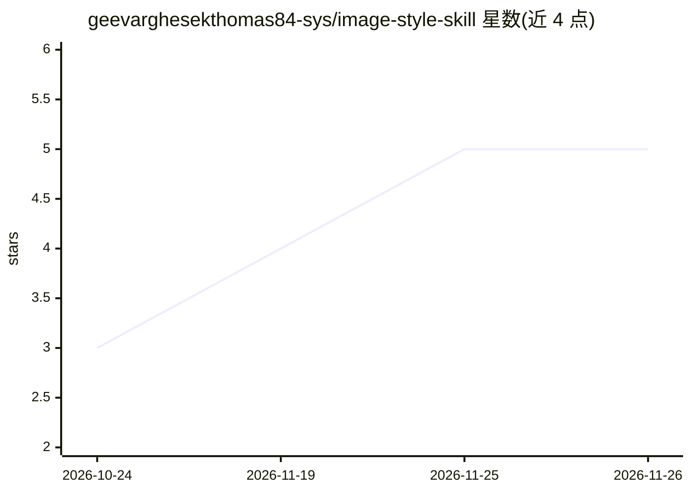

# geevarghesekthomas84-sys/image-style-skill

⭐ — · [GitHub]() · 个人维护

**为 AI 图像创作者提供 403 条斜杠命令生成各工具格式的提示词**

SlashFrame（原名 image-style）是一套提示词扩展命令集：用户在请求中加入斜杠命令（如 /storm /goldenhour /85mm /16:9），由扩展器按各目标工具的格式规则生成完整提示词，支持 Midjourney 旗标、Stable Diffusion 负面提示、Kling 负面字段、Flux/Gemini 句式等 8 种目标工具。内置规则约束：最多 8 个风格修饰符、冲突命令取后者、多比例各出一条提示词、未知命令保留为文本并报告。提供 14 个内置预设，支持用户保存自定义命令组合。通过 Claude Code 插件/技能、Claude.ai、ChatGPT Custom GPT、Gemini Gem 与 ComfyUI 节点分发。

## 筛选速览

| 维度 | 判定 | 备注 |
|---|---|---|
| AI 角色 | `ai-enhanced` | 去掉 AI 部分产品仍成立 |
| 许可风险 | `permissive` | — |
| 部署形态 | `None` |  |
| 模型依赖 | — | README 未给出锁定关系 |
| 硬件要求 | — | 无带数字的原话,不猜 |
| 安装摩擦 | `low` | 无编译、无系统依赖或容器化 |
| 成熟度 | — | 结构信号不足 |

## 能力要点

- 403 条命令按风格、镜头、视频运动、比例、避免清单等 9 组组织
- 同一请求可按目标工具切换输出格式（/mj、/flux、/gemini、/kling 等）
- 规则引擎处理冲突命令、修饰符上限与未知命令报告
- 14 个内置预设及自定义命令组合（/mylook）保存复用

## 适用场景

- 为 Midjourney 或 Flux 快速写出格式正确的图像提示词
- 同一构思批量生成 16:9 与 9:16 两种比例的提示词
- 在 ComfyUI 工作流中以节点方式扩展提示词
- 在 Claude/ChatGPT/Gemini 中通过技能或自定义指令使用统一风格词汇

## 场景标签

`提示工程` `图像生成` · 领域:Agent 开发

## 证据(README 行号)

> L1: SlashFrame: 403 slash commands for AI image prompts
> L164: |🧩 **Right format per tool**|Midjourney flags, Stable Diffusion negative prompt, Kling negative field, Flux and Ge
> L224: |**Claude Code** (plugin)|`dist/marketplace`|`claude plugin marketplace add geevarghesekthomas84-sys/image-style-s

## 星数曲线

2026-10-24 3 → 2026-11-26 5（+2）

---
*卡片 v1 · prompt 1.4 · 生成 2026-11-21 · 置信度 high · 依据 README sha `fd53f97aaf70` · [字段定义](../../DATASET.md)*
