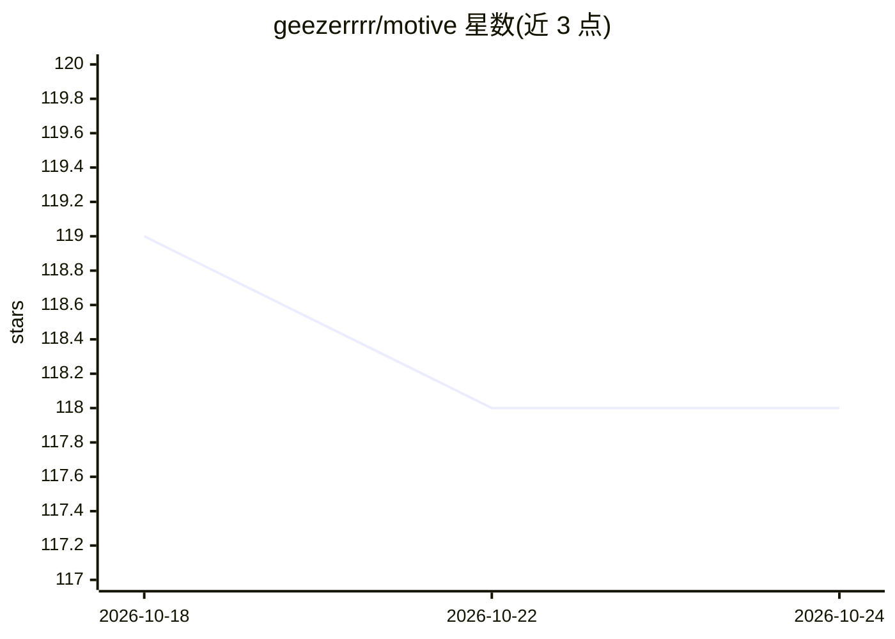

# geezerrrr/motive

⭐ 118 · Swift · MIT · 推送 2026-10-10 · [GitHub](https://github.com/geezerrrr/motive) · [官网](https://motivework.app) · 个人维护

**macOS 菜单栏后台运行 AI agent 并在需要时弹窗找你的应用**

Swift/SwiftUI 编写的 macOS 菜单栏应用，以 OpenCode 作为 agent 引擎在后台执行任务：无需盯着窗口或终端，当 agent 需要权限确认或有提问时，从菜单栏弹出系统原生弹窗，无论用户在哪个应用中都能响应。支持多会话并行、三级信任模式（Careful/Balanced/Yolo）、细粒度文件权限策略，可接入 Claude、OpenAI、Gemini、Ollama 等多种 provider，内置 50+ 技能并支持自定义。API key 存于 macOS Keychain，会话数据留在本机。要求 macOS 15.0 及以上。

## 筛选速览

| 维度 | 判定 | 备注 |
|---|---|---|
| AI 角色 | `ai-native` | 本体是模型或模型工具 |
| 许可风险 | `permissive` | MIT |
| 部署形态 | `desktop` | 安装包/桌面程序 |
| 模型依赖 | local-ok | 支持本地模型 |
| 硬件要求 | — | 无带数字的原话,不猜 |
| 安装摩擦 | `low` | 无编译、无系统依赖或容器化 |
| 成熟度 | — | 结构信号不足 |

## 能力要点

- 后台运行 agent，需要批准时以系统原生弹窗触达用户
- 三级信任模式与逐操作的 Always Allow / Ask / Deny 权限策略
- 多 provider 接入（Claude/OpenAI/Gemini/Ollama/OpenRouter/Azure/Bedrock），可选 Ollama 全离线运行
- 50+ 内置技能与 ~/.motive/skills/ 自定义技能，无代码修改

## 适用场景

- 让 AI agent 在后台改代码、跑脚本，我去做别的事
- 离开终端后不错过 agent 的权限确认弹窗
- 并行运行多个 agent 任务并用菜单栏图标查看进度

## 场景标签

`编码 Agent` · 领域:编码与开发

## 证据(README 行号)

> L6:  A macOS menu bar app that runs AI agents in the background — and finds you when they need approval.
> L22: Under the hood it uses OpenCode as the agent engine. Motive doesn't try to be a better agent — it just makes sure t
> L116: Anything OpenCode can do — refactor code, generate files, run scripts, organize projects, write docs, and more. Op

## 星数曲线

2026-10-18 119 → 2026-10-24 118（-1）

---
*卡片 v1 · prompt 1.4 · 生成 2026-10-23 · 置信度 high · 依据 README sha `d54d067905c8` · [字段定义](../../DATASET.md)*
