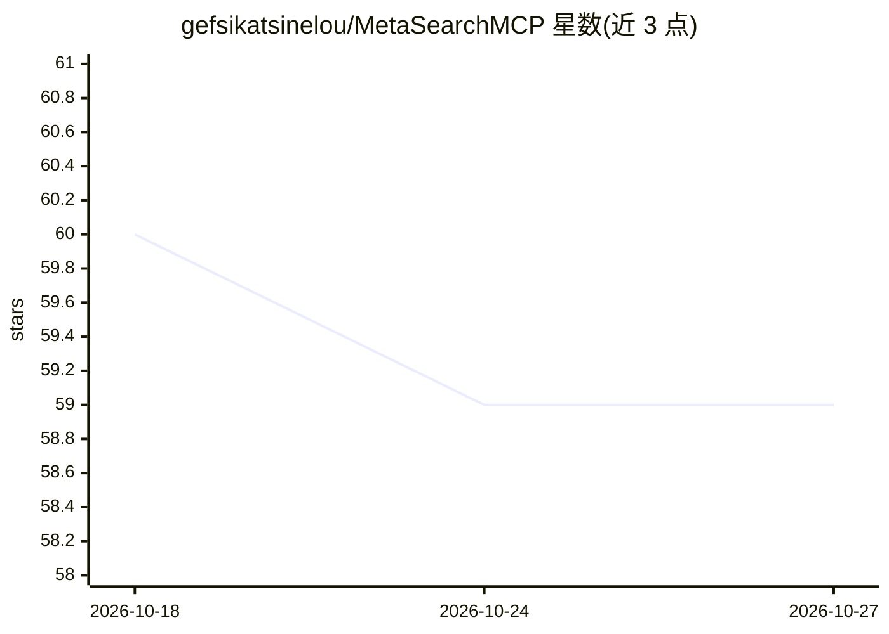

# gefsikatsinelou/MetaSearchMCP

⭐ 59 · Python · MIT · 推送 2026-10-19 · [GitHub](https://github.com/gefsikatsinelou/MetaSearchMCP) · 个人维护

**面向 LLM agent 的 MCP 元搜索后端与结构化搜索 API**

Python FastAPI 实现的元搜索网关：并发聚合多个搜索提供商，将结果规范化为统一 JSON schema，提供 HTTP API（含 OpenAPI 文档）与 stdio MCP server，可接入 Claude Desktop、Cline、Continue 等 MCP 客户端。覆盖网页搜索（Google/DuckDuckGo/Bing 等）、知识参考、地理编码、开发者源（GitHub/PyPI 等）数十个提供商，支持按名称或语义标签选择提供商、超时隔离、部分失败处理、跨引擎去重与结果数上限。Google 路径优先使用本仓库实现的 HTML 抓取，数据中心 IP 下可能被封锁。

## 筛选速览

| 维度 | 判定 | 备注 |
|---|---|---|
| AI 角色 | `ai-ecosystem` | LLM/agent 周边工具 |
| 许可风险 | `permissive` | MIT |
| 部署形态 | `self-host` | docker 或自建部署 |
| 模型依赖 | — | README 未给出锁定关系 |
| 硬件要求 | — | 无带数字的原话,不猜 |
| 安装摩擦 | `low` | 无编译、无系统依赖或容器化 |
| 成熟度 | — | 结构信号不足 |

## 能力要点

- 并发多提供商聚合与统一结果 schema
- MCP server（stdio）可接入 Claude Desktop、Cline、Continue 等客户端
- 提供商级超时隔离、部分失败处理与跨引擎去重
- 按显式名称或语义标签（web/academic/code 等）选择提供商

## 适用场景

- 为 LLM agent 或 MCP 客户端提供可预测的结构化搜索工具
- RAG/搜索管线中聚合多引擎结果并去重
- 通过 HTTP API 为 AI 工作流提供统一搜索接口

## 场景标签

 · 领域:LLM 基础设施/搜索

## 证据(README 行号)

> L3: Open-source metasearch backend for MCP, AI agents, and LLM workflows.
> L5: MetaSearchMCP aggregates results from multiple search providers, normalizes them into a stable JSON schema, and expo
> L29: - MCP server over stdio for Claude Desktop, Cline, Continue, and similar clients

## 星数曲线

2026-10-18 60 → 2026-10-27 59（-1）

---
*卡片 v1 · prompt 1.4 · 生成 2026-10-24 · 置信度 high · 依据 README sha `988de4af4c30` · [字段定义](../../DATASET.md)*
