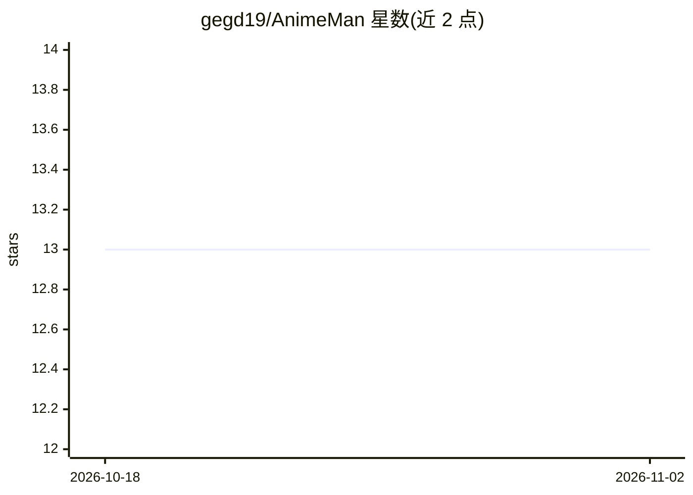

# gegd19/AnimeMan

⭐ 13 · Python · 推送 2026-10-18 · [GitHub](https://github.com/gegd19/AnimeMan) · 个人维护 · 中文 README

**面向 NAS 用户的动漫媒体库自动整理工具（AI 辅助）**

用 Python/Flask 编写的动漫媒体库整理 Web 应用，面向 NAS 用户与动漫收藏者：内置 anitopy 解析动漫文件名，默认以硬链接（跨盘降级符号链接）方式在 Emby/Jellyfin/Plex 媒体库中生成文件入口，保种不复制；生成 NFO 并经 TMDB API 下载海报元数据；支持特典/OVA 映射到 S00、字幕分组匹配与 ffsubsync 调轴。AI 为可选功能：接入 DeepSeek/OpenAI 等修正解析失败的文件名。提供 Docker Compose 一键部署与源码运行两种方式，运行需自备 TMDB API Key。

## 筛选速览

| 维度 | 判定 | 备注 |
|---|---|---|
| AI 角色 | `ai-enhanced` | 去掉 AI 部分产品仍成立 |
| 许可风险 | `none` | — |
| 部署形态 | `self-host` | docker 或自建部署 |
| 模型依赖 | — | README 未给出锁定关系 |
| 硬件要求 | — | 无带数字的原话,不猜 |
| 安装摩擦 | `low` | 无编译、无系统依赖或容器化 |
| 成熟度 | — | 结构信号不足 |

## 能力要点

- anitopy 动漫文件名解析，AI（DeepSeek/OpenAI 等）修正失败文件名（可选）
- 硬链接保种模式，跨盘自动降级符号链接
- 生成 NFO/TMDB 元数据，特典 OVA 映射规则归类 S00
- 失败缓存批量修正与移动端友好的响应式 Web 面板

## 适用场景

- PT 保种的同时让 Emby/Jellyfin 媒体库整洁可刮削
- 批量整理压制组命名混乱的动漫 BDRip 与特典/OVA
- 在手机上管理 NAS 媒体库并批量修正处理失败的文件

## 场景标签

 · 领域:媒体库管理/NAS 工具

## 证据(README 行号)

> L5: **🤖 AI 驱动的动漫媒体库全自动整理神器 · 专为 NAS 用户与二次元收藏家设计**
> L59: - **不复制、不移动、不损坏做种**。通过硬链接在 Emby/Jellyfin 媒体库中生成文件入口，源文件继续保种上传。
> L215: |`ai_parser.enabled`|❌|开启 AI 解析，强烈推荐！|

## 星数曲线

2026-10-18 13 → 2026-11-02 13（+0）

---
*卡片 v1 · prompt 1.4 · 生成 2026-10-31 · 置信度 mid · 依据 README sha `28ebfe791116` · [字段定义](../../DATASET.md)*
