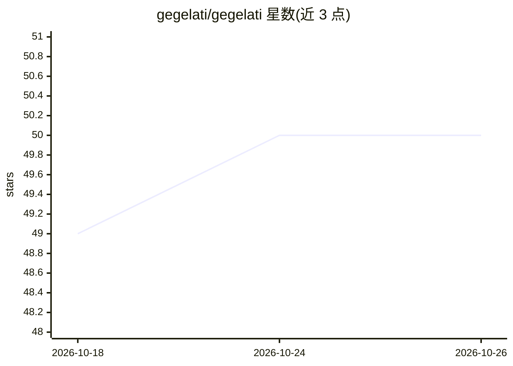

# gegelati/gegelati

⭐ 50 · C++ · NOASSERTION · 推送 2026-10-20 · [GitHub](https://github.com/gegelati/gegelati) · 组织维护

**C++ 强化学习框架：基于 TPG 训练智能体**

由法国 IETR 研究所开发的 C++ 共享库，用于基于 Tangled Program Graphs（TPG）训练强化学习智能体。构建依赖 CMake 与 Doxygen（文档生成为构建强制步骤），提供 Windows（MSVC）预编译二进制或从源码编译安装，通过 CMake 与 C++ 工程链接使用。附带教程与示例应用仓库（Atari 游戏、倒立摆、MNIST、井字棋、机械臂等），跨平台 CI 覆盖 ubuntu/windows/macos。以 CeCILL-C 许可分发，可按 DASIP 2021 论文引用。

## 筛选速览

| 维度 | 判定 | 备注 |
|---|---|---|
| AI 角色 | `ai-native` | 本体是模型或模型工具 |
| 许可风险 | `none` | NOASSERTION |
| 部署形态 | `None` |  |
| 模型依赖 | — | README 未给出锁定关系 |
| 硬件要求 | — | 无带数字的原话,不猜 |
| 安装摩擦 | `medium` | 含编译或系统依赖之一 |
| 成熟度 | — | 结构信号不足 |

## 能力要点

- 基于 Tangled Program Graphs（TPG）的强化学习训练框架
- C++ 共享库，可移植、有单元测试与 Doxygen 文档
- 提供 Windows MSVC 预编译二进制与 CMake 源码构建两种安装方式
- 配套教程与示例应用（Atari、MNIST、倒立摆等）

## 适用场景

- 在自定义学习环境上训练强化学习智能体
- 研究 Tangled Program Graphs 方法并复现论文实验
- 以 C++ 库形式将 TPG 学习集成到自己的工程

## 场景标签

`强化学习` · 领域:训练与推理

## 证据(README 行号)

> L8: GEGELATI _\[dʒedʒelati\]_ is a fresh open-source reinforcement learning framework for training artificial intelligen
> L92: *K. Desnos, N. Sourbier, P.-Y. Raumer, O. Gesny and M. Pelcat. GEGELATI: Lightweight Artificial Intelligence throug

## 星数曲线

2026-10-18 49 → 2026-10-26 50（+1）

---
*卡片 v1 · prompt 1.4 · 生成 2026-10-24 · 置信度 high · 依据 README sha `3af368e98c22` · [字段定义](../../DATASET.md)*
