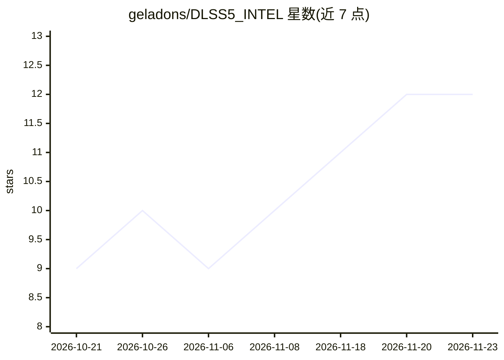

# geladons/DLSS5_INTEL

⭐ 12 · C++ · Apache-2.0 · 推送 2026-10-13 · [GitHub](https://github.com/geladons/DLSS5_INTEL) · [官网](https://geladons.github.io/DLSS5_INTEL/) · 个人维护

**在 Intel Arc GPU 上实时运行 DLSS 5 神经渲染链的爱好者研究项目**

将 71 块结构的 DLSSNR 神经渲染模型通过 Vulkan cooperative-matrix（XMX 核心）部署在 Intel Arc GPU 上，对游戏画面做实时神经后处理：Vulkan 游戏经隐式 Vulkan 层拦截 present，DX9/10/11 经 DXVK 转路由，DX12 经自定义 DXGI 代理，另有处理整个桌面的屏幕/窗口模式（DDA 捕获 + 点击穿透 overlay）。附带 Python/Tk 管理器，提供自动游戏发现与逐游戏 DLL 部署。README 明确声明这是 proof-of-concept 演示构建，不分发 NVIDIA 模型权重，1080p 级性能仍属演示阶段。

## 筛选速览

| 维度 | 判定 | 备注 |
|---|---|---|
| AI 角色 | `ai-native` | 本体是模型或模型工具 |
| 许可风险 | `permissive` | Apache-2.0 |
| 部署形态 | `desktop` | 安装包/桌面程序 |
| 模型依赖 | — | README 未给出锁定关系 |
| 硬件要求 | — | 无带数字的原话,不猜 |
| 安装摩擦 | `medium` | 含编译或系统依赖之一 |
| 成熟度 | `idea` | |

## 能力要点

- 71 块 DLSSNR 链在 Intel Arc XMX 核心上实时运行，x64 进程内传输延迟约 1.5–2.5 ms
- 覆盖 Vulkan/DX9/DX10/DX11/DX12 游戏，DX9 经 DXVK、DX12 经 DXGI 代理接入
- 1:2 节奏的帧生成（中间帧捕获 + 插值）与残差重建保留原生 HUD/文字细节
- 管理器提供 Steam/Epic/GOG 游戏自动发现与逐游戏 DLL 部署

## 适用场景

- 在 Intel Arc GPU 上为老游戏（如 GTA IV）实时启用神经增强
- 研究 Vulkan cooperative-matrix 上运行 Transformer 类渲染网络的方法
- 通过屏幕/窗口模式对整个桌面做流媒体演示用的神经处理

## 场景标签

`图像视频处理` `推理引擎` `科研工具` · 领域:学习与行业

## 证据(README 行号)

> L3: **DLSS 5 Neural Rendering, running live on Intel Arc — a fan research project.**
> L7: XMX cores) instead of NVIDIA tensor cores. It processes **live game frames at
> L25: This is a working proof-of-concept, not a usable everyday tool. What you should

## 星数曲线

2026-10-21 9 → 2026-11-23 12（+3）

---
*卡片 v1 · prompt 1.4 · 生成 2026-11-18 · 置信度 mid · 依据 README sha `46125d5f0c20` · [字段定义](../../DATASET.md)*
