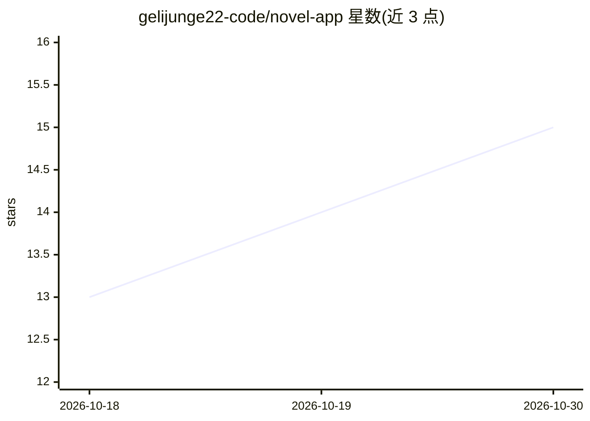

# gelijunge22-code/novel-app

⭐ 15 · Python · AGPL-3.0 · 推送 2026-09-22 · [GitHub](https://github.com/gelijunge22-code/novel-app) · 个人维护 · 中文 README

**自托管的长篇小说 AI 写作台：多 Agent 分工写作**

面向长篇写作的自托管工具，由 FastAPI 后端、原生 JavaScript 网页版与安卓客户端三部分组成，稿件与设定仅保存在本机。写作流程拆分为出方案、挑刺、取料查证、写正文、复审改稿多个环节，每个环节为独立模型调用，支持多角色分工或单人两种执行模式；内置世界状态引擎（实体/事实入库并检测设定冲突）、568 条中文写作规则检查、段落朗读与默认关闭的联网搜索。模型可逐个配置上下文上限、输出上限等参数。克隆源码运行，需 Python 3.11+，数据存于 data/ 目录。

## 筛选速览

| 维度 | 判定 | 备注 |
|---|---|---|
| AI 角色 | `ai-native` | 本体是模型或模型工具 |
| 许可风险 | `viral` | AGPL-3.0 |
| 部署形态 | `None` |  |
| 模型依赖 | — | README 未给出锁定关系 |
| 硬件要求 | — | 无带数字的原话,不猜 |
| 安装摩擦 | `medium` | 含编译或系统依赖之一 |
| 成熟度 | — | 结构信号不足 |

## 能力要点

- 写作流程拆分为多环节，每环节独立模型调用，写作与审阅分离
- 世界引擎：人物/势力记录为带状态主体，检测新稿与既有设定冲突
- 568 条中文写作规则检查（填充词、机械过渡等），规则表可修改
- 网页版 + 安卓客户端 + 稿件全部本地保存的自托管架构

## 适用场景

- 长篇小说创作中让多个 AI 角色分工写稿、审稿与查证
- 维护人物、势力等设定的一致性并检测冲突
- 在自有设备上部署写作环境，稿件不上传第三方

## 场景标签

`AI 写作` · 领域:内容生成

## 证据(README 行号)

> L65: 一次生成可拆分为多个环节：出方案 → 逐条挑刺 → 取料查证 → 写正文 → 复审改稿。
> L11: - **后端**：Python（FastAPI），负责数据、模型调用与写作流程编排

## 星数曲线

2026-10-18 13 → 2026-10-30 15（+2）

---
*卡片 v1 · prompt 1.4 · 生成 2026-10-30 · 置信度 high · 依据 README sha `c762953a72e4` · [字段定义](../../DATASET.md)*
