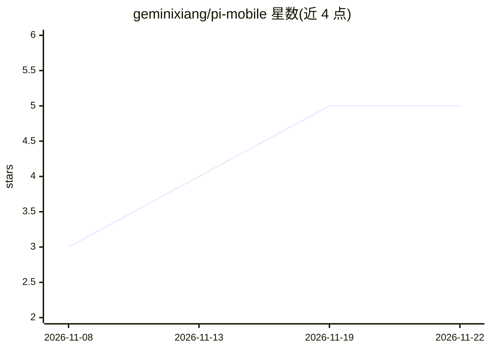

# geminixiang/pi-mobile

⭐ 5 · TypeScript · MIT · 推送 2026-11-18 · [GitHub](https://github.com/geminixiang/pi-mobile) · 个人维护 · 中文 README

**非官方 Android 客户端：在手机上运行 pi coding agent**

非官方社群开发的 pi 移动端应用，让 AI agent 直接跑在 Android 手机上。每个 Bot 有独立的任务说明、记忆、自动化与持续对话（过长自动压缩）。通过 pi-ai 接入多家模型供应商并支持自订端点；手机能力（天气、行事历、通知、语音、SQLite 记账等）作为工具按 Bot 开关，支持 MCP 连接 Notion、Linear 等服务；可选把 tailnet 上的 Mac/Linux 电脑交给 Bot 操作。凭据只存手机，不进 sandbox。需 Android 16 以上 arm64，作者声明项目仍在早期。

## 筛选速览

| 维度 | 判定 | 备注 |
|---|---|---|
| AI 角色 | `ai-ecosystem` | LLM/agent 周边工具 |
| 许可风险 | `permissive` | MIT |
| 部署形态 | `None` |  |
| 模型依赖 | local-ok | 支持本地模型 |
| 硬件要求 | — | 无带数字的原话,不猜 |
| 安装摩擦 | `low` | 无编译、无系统依赖或容器化 |
| 成熟度 | `idea` | |

## 能力要点

- 每个 Bot 具备独立记忆、自动化与持续对话（过长自动压缩）
- 锁屏、后台及 app 被清除后 agent 仍继续运行
- 支持自定义 OpenAI/Anthropic 兼容端点，凭据不进 sandbox
- 可选把 tailnet 上的 Mac/Linux 电脑交给 Bot 操作

## 适用场景

- 手机上随时随地运行长驻 agent 任务
- 定时、戴耳机、收到通知等条件触发自动化
- 让 Bot 远程操作自家电脑或其容器中的项目
- 用手机能力（闹钟、通知、行事历）编排日常任务

## 场景标签

`编码 Agent` `AI 助手` · 领域:编码与开发

## 证据(README 行号)

> L16: - **模型用你自己的 key**：透過 pi-ai 接 OpenAI、Anthropic、Gemini、OpenRouter、xAI、DeepSeek 等供應商，也能接任何 OpenAI 或 Anthropic 相容的端點（自架
> L19: - **交給你的電腦**：在 tailnet 上的 Mac 或 Linux 跑一行指令，Bot 就能直接操作它，或在它的容器裡工作。
> L55: pi mobile 是非官方的社群專案，與 pi 的開發者 Earendil 沒有任何關聯。它使用 npm 上公開發布的 pi 套件（`@earendil-works/pi-durable`、`pi-ai`、`pi-env`、`p

## 星数曲线

2026-11-08 3 → 2026-11-22 5（+2）

---
*卡片 v1 · prompt 1.4 · 生成 2026-11-21 · 置信度 high · 依据 README sha `ba8d206b9397` · [字段定义](../../DATASET.md)*
