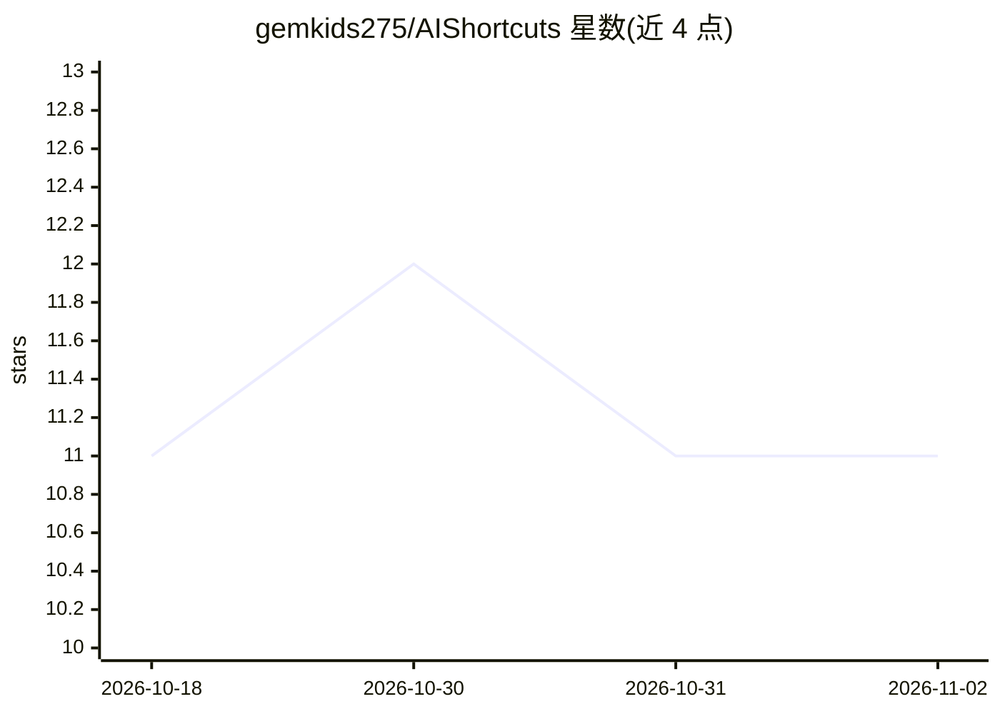

# gemkids275/AIShortcuts

⭐ 11 · Swift · GPL-3.0 · 推送 2026-11-01 · [GitHub](https://github.com/gemkids275/AIShortcuts) · [官网](https://aishortcuts.github.io/) · 个人维护

**系统级 AI 写作助手：任意应用选中文字按热键就地润色/改写/摘要**

WritingTools 的 fork，由个人维护。在 macOS/Windows/Linux 上运行：任意应用中选中文本、按全局热键、选择命令（Proofread/Rewrite/Summary 等 8 个内置命令或自定义指令），AI 结果就地替换原文或打开可继续对话的响应窗口。支持 Gemini、OpenAI 兼容、Anthropic、Mistral、OpenRouter 云端提供商及 Ollama/LM Studio/llama.cpp 本地模型，macOS 另支持 MLX 端上模型，可为每条命令单独指定提供商。无遥测。三平台均提供预构建安装包；Linux 版需 X11 会话及 xclip/xsel，Wayland 下全局热键不可用。GPL-3.0 许可。

## 筛选速览

| 维度 | 判定 | 备注 |
|---|---|---|
| AI 角色 | `ai-native` | 本体是模型或模型工具 |
| 许可风险 | `viral` | GPL-3.0 |
| 部署形态 | `desktop` | 安装包/桌面程序 |
| 模型依赖 | local-ok | 支持本地模型 |
| 硬件要求 | — | 无带数字的原话,不猜 |
| 安装摩擦 | `low` | 无编译、无系统依赖或容器化 |
| 成熟度 | — | 结构信号不足 |

## 能力要点

- 任意应用内选中文本+全局热键就地执行 8 种内置命令或自定义指令
- 支持云端（Gemini/OpenAI 兼容/Anthropic/Mistral/OpenRouter）与本地（Ollama/LM Studio/llama.cpp/MLX）模型，按命令指定提供商
- Command Manager 支持自定义命令、拖拽排序、导入导出与备份
- 三平台预构建安装包，附 SHA-256 校验和与构建来源证明

## 适用场景

- 写邮件或文档时快速润色、改写或总结，无需切换到聊天窗口
- 通过自定义命令把选中文字翻译、转为列表等
- 用本地模型（Ollama/MLX）做私有化的文本处理

## 场景标签

`AI 写作` · 领域:内容生成

## 证据(README 行号)

> L3: **Select text in any app, press a hotkey, and let AI fix, rewrite or summarize it in place.**
> L17: - **One hotkey, any app.** Select text, press the shortcut, pick a command. No copy-paste into a chat tab.
> L46: 3. Pick a command: **Proofread**, **Rewrite**, **Friendly**, **Professional**, **Concise**, **Summary**, **Key Poin

## 星数曲线

2026-10-18 11 → 2026-11-02 11（+0）

---
*卡片 v1 · prompt 1.4 · 生成 2026-11-02 · 置信度 mid · 依据 README sha `896161b8346a` · [字段定义](../../DATASET.md)*
