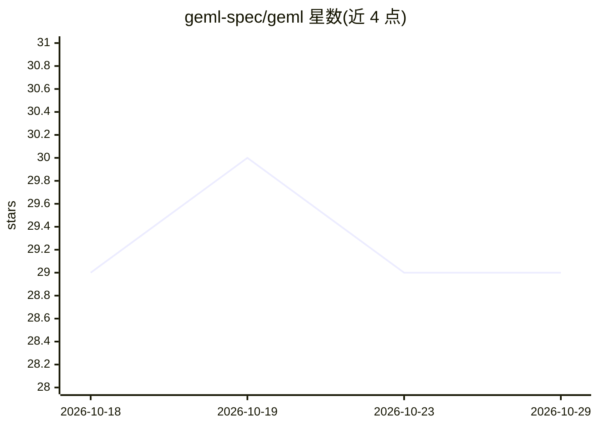

# geml-spec/geml

⭐ 29 · JavaScript · MIT · 推送 2026-10-28 · [GitHub](https://github.com/geml-spec/geml) · [官网](https://geml-spec.github.io/) · 组织维护 · 中文 README

**面向人机共写的结构化纯文本标记语言与 CLI 工具**

GEML 是一种轻量级标记语言，用统一的类型化块（typed block）承载代码、表格、图表、数学、元数据等内容，每块可寻址（#id），配套 CLI 提供 list/get/set/replace/history 等动词，支持对 Markdown 现有文件直接按节读写，无需转换；.gemlhistory 边车记录可回滚的修订。设计目标是让 AI agent 只把目标块载入上下文（AST 级确定性读写），而非整文件往返。代码 MIT、规范 CC BY 4.0 许可，声明 spec 1.0。给需要人与 agent 高频共写文档的开发者使用；功能声称覆盖完整格式规范与校验器。

## 筛选速览

| 维度 | 判定 | 备注 |
|---|---|---|
| AI 角色 | `ai-ecosystem` | LLM/agent 周边工具 |
| 许可风险 | `permissive` | MIT |
| 部署形态 | `library` | 以包/库形式分发 |
| 模型依赖 | — | README 未给出锁定关系 |
| 硬件要求 | — | 无带数字的原话,不猜 |
| 安装摩擦 | `medium` | 含编译或系统依赖之一 |
| 成熟度 | — | 结构信号不足 |

## 能力要点

- 类型化块统一语法，块内元素有坐标可 get/set 精确读写
- 可直接对现有 Markdown 按节寻址读写，无需转换
- .gemlhistory 边车支持块级原子回滚与修订历史
- Profile 声明式扩展领域词汇，不需要新语法

## 适用场景

- 让 AI agent 只读写文档目标块，降低上下文 token 消耗
- 人机共写的技术文档与知识库，保持单一事实来源
- 对文档做块级版本管理与回滚

## 场景标签

 · 领域:开发者工具/文档基础设施

## 证据(README 行号)

> L10: GEML is **a lightweight markup language with uniform, addressable blocks and standard verbs**.
> L14: **You can start without changing a thing.** `geml list`, `geml find` and `geml get` address the Markdown you alread
> L138: GEML invents no heavy new runtime. Borrowing from the **REST** architectural style of Dr. Roy Fielding's dissertat

## 星数曲线

2026-10-18 29 → 2026-10-29 29（+0）

---
*卡片 v1 · prompt 1.4 · 生成 2026-10-26 · 置信度 low · 依据 README sha `f4b0d42683b2` · [字段定义](../../DATASET.md)*
