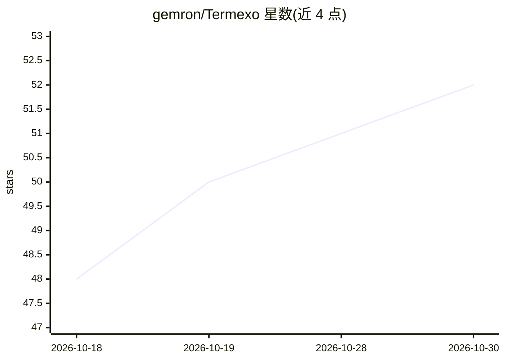

# gemron/Termexo

⭐ 52 · TypeScript · MIT · 推送 2026-10-29 · [GitHub](https://github.com/gemron/Termexo) · [官网](https://www.termexo.com) · 个人维护 · 中文 README

**Windows 工作台：统一运行并远程接管多个 AI 编码代理终端**

基于 Tauri 2 + Angular 的 Windows 桌面应用，把 Claude Code、Codex CLI、OpenCode、Antigravity、Grok Build、Pi Agent 六种代理放进真实 PTY 终端并排运行。通过本地 MCP 服务器让一个已连接的 AI 查找、向另一个代理终端发送提示词并读取回复；提供工作区管理、任务看板、等待输入/审批状态通知、原生会话恢复、Git 会话 diff 视图、模型与账号配置档案。远程访问经自建 relay、可信局域网或 VPN 从手机重连终端，MCP 与远程访问默认关闭。仅限 Windows 桌面端，需 Windows 10 17763+ 与 WebView2；不包含模型订阅。

## 筛选速览

| 维度 | 判定 | 备注 |
|---|---|---|
| AI 角色 | `ai-ecosystem` | LLM/agent 周边工具 |
| 许可风险 | `permissive` | MIT |
| 部署形态 | `desktop` | 安装包/桌面程序 |
| 模型依赖 | — | README 未给出锁定关系 |
| 硬件要求 | — | 无带数字的原话,不猜 |
| 安装摩擦 | `low` | 无编译、无系统依赖或容器化 |
| 成熟度 | — | 结构信号不足 |

## 能力要点

- 本地 MCP 让 AI 查找其他代理终端、发送提示词并读取回复
- 六个代理类型并排运行于真实 PTY 终端，1-6 行列自定义网格
- 自建 relay / LAN / VPN 的手机远程访问，AES-256-GCM 会话加密
- 跨项目搜索并恢复各 CLI 原生会话（claude --resume 等）

## 适用场景

- 同时跑多个 AI 编码工具时减少窗口切换、统一查看状态
- 让一个 AI 通过 MCP 操控其他代理终端执行任务
- 人离开桌面后从手机回答审批、查看长任务进度
- 为 Claude Code 切换 DeepSeek/GLM 等不同模型提供方并管理账号档案

## 场景标签

`编码 Agent` · 领域:编码与开发

## 证据(README 行号)

> L25: **Use MCP to let AI operate Claude Code, Codex, OpenCode, Pi Agent, Grok Build, and Antigravity terminals.**
> L43: With several AI coding tools running, you spend time sending requests, checking progress, and copying replies betwe

## 星数曲线

2026-10-18 48 → 2026-10-30 52（+4）

---
*卡片 v1 · prompt 1.4 · 生成 2026-10-25 · 置信度 high · 依据 README sha `61a3e62e5f6f` · [字段定义](../../DATASET.md)*
