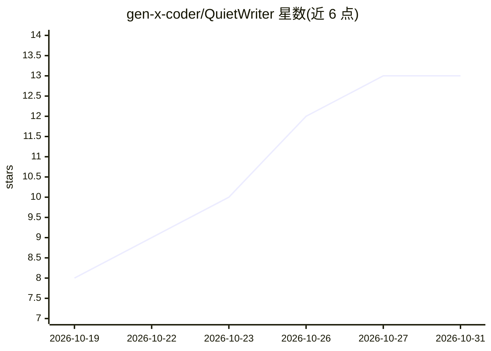

# gen-x-coder/QuietWriter

⭐ 13 · Python · GPL-3.0 · 推送 2026-10-29 · [GitHub](https://github.com/gen-x-coder/QuietWriter) · [官网](https://www.dutchscrum.nl/quietwriter/) · 个人维护

**面向小说作者的本地离线写作应用，含可选 AI 阅读反馈助手**

QuietWriter 是一个运行于本地、无需账号的图书与长文写作桌面应用（Python/PySide6），提供手稿、章节、场景、规划、人物、开放点、Darlings 暂存文本与版本历史管理，可导出 DOCX/EPUB/PDF/Markdown，整本书可存为单一 .qwbook 文件。AI 定位为'共读者'（Meelezer）：仅提供反馈、查找不一致与事实核对，不代写正文；可通过 Ollama 本地模型或 OpenRouter 使用，也可完全关闭。Windows 提供 PyInstaller 制作的便携版（含 SHA-256 校验），Linux/macOS 需从源码运行，许可为 GPLv3。

## 筛选速览

| 维度 | 判定 | 备注 |
|---|---|---|
| AI 角色 | `ai-enhanced` | 去掉 AI 部分产品仍成立 |
| 许可风险 | `viral` | GPL-3.0 |
| 部署形态 | `library` | 以包/库形式分发 |
| 模型依赖 | local-ok | 支持本地模型 |
| 硬件要求 | — | 无带数字的原话,不猜 |
| 安装摩擦 | `low` | 无编译、无系统依赖或容器化 |
| 成熟度 | — | 结构信号不足 |

## 能力要点

- 可选 AI Meelezer：给反馈、查不一致、核对事实，不代写正文，可关闭
- 通过 Ollama 本地模型或 OpenRouter 接入 AI
- 版本历史、恢复与 .qwbook 单文件导出/导入（含完整性检查）
- 导出支持 DOCX/EPUB/PDF/Markdown，Windows 便携版附带 SHA-256 校验

## 适用场景

- 在无账号、无云端的本地环境中写小说和长文
- 写卡住时留'开放点'并后续回头补齐
- 请 AI 对已有稿子做反馈和一致性检查而不让它代写
- 将完稿导出为 EPUB/PDF/DOCX 等格式

## 场景标签

`AI 写作` `AI 助手` · 领域:对话与助手

## 证据(README 行号)

> L18: QuietWriter is een lokale schrijfomgeving voor boeken en langere teksten.
> L82: QuietWriter heeft een **AI Meelezer**.
> L86: De Meelezer kan feedback geven, inconsistenties zoeken, feiten controleren en rekening houden met je boek, personag
> L104: Zet hem uit.
> L106: QuietWriter blijft verrassend genoeg gewoon een schrijfprogramma.

## 星数曲线

2026-10-19 8 → 2026-10-31 13（+5）

---
*卡片 v1 · prompt 1.4 · 生成 2026-10-31 · 置信度 mid · 依据 README sha `13b31c07ca5b` · [字段定义](../../DATASET.md)*
