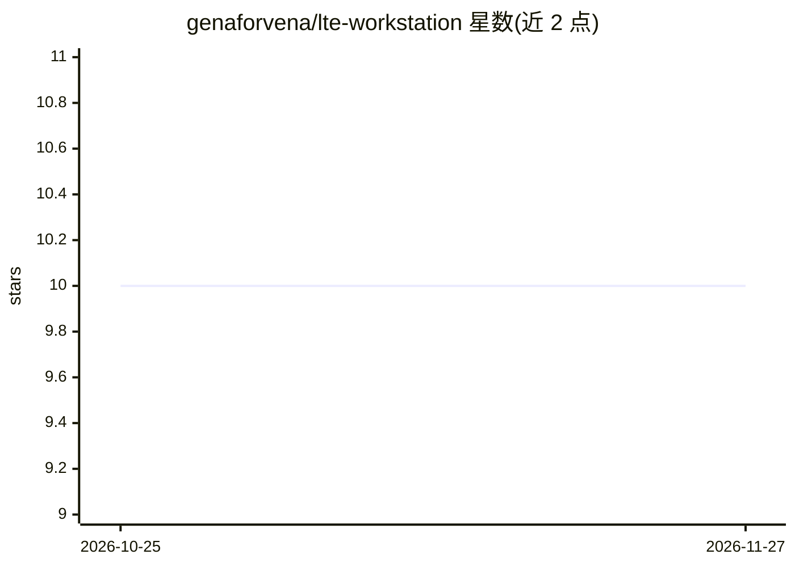

# genaforvena/lte-workstation

⭐ 10 · Shell · CC0-1.0 · 推送 2026-10-21 · [GitHub](https://github.com/genaforvena/lte-workstation) · 个人维护

**把自有多台设备组成自维护多 agent 协作网格的工具集**

把桌面、笔记本、手机、路由器等 SSH 可达设备组成节点网格，节点分为 minds（agent CLI）、senses（摄像头/麦克风/GPS 等）、actuators、connectivity、compute 五类。agent 通过共享 tmux 终端与自由文本标记协调，无中心节点；知识以文本形式节点间传播，新机器克隆仓库并运行 bootstrap.sh 即可加入节点。要求一台 Linux 机器和一个 agent CLI（Codex/Claude Code/opencode），第二节点需 Tailscale。仓库已归档，后继项目为 Mishe。

## 筛选速览

| 维度 | 判定 | 备注 |
|---|---|---|
| AI 角色 | `ai-ecosystem` | LLM/agent 周边工具 |
| 许可风险 | `viral` | CC0-1.0 |
| 部署形态 | `None` |  |
| 模型依赖 | — | README 未给出锁定关系 |
| 硬件要求 | — | 无带数字的原话,不猜 |
| 安装摩擦 | `low` | 无编译、无系统依赖或容器化 |
| 成熟度 | — | 结构信号不足 |

## 能力要点

- 节点自声明能力，无中心服务器，任一节点睡眠由其他接管
- 以共享 tmux 终端文本标记作为 agent 间协调机制
- mesh-task/mesh-doctor 等任务路由、自检与故障复用工具
- 能力须产出可验证工件，失败时输出 UNKNOWN 而非假阳性

## 适用场景

- 用自有闲置设备搭建多 agent 协作的家用节点网格
- 通过手机经 SSH 接入并参与 agent 协调
- 让 agent 集群自动处理重复出现的系统故障

## 场景标签

`多智能体` · 领域:Agent 开发

## 证据(README 行号)

> L38: - **minds** — agents (Codex / Claude Code / opencode / …)
> L118: **What you actually need:** a Linux box, an agent CLI on it (Codex, Claude Code, opencode, …), and
> L32: **No fixed mind.** No central server, no master node. A *mind* is any node where an agent is awake;

## 星数曲线

2026-10-25 10 → 2026-11-27 10（+0）

---
*卡片 v1 · prompt 1.4 · 生成 2026-11-19 · 置信度 high · 依据 README sha `3ecfaa823ebd` · [字段定义](../../DATASET.md)*
