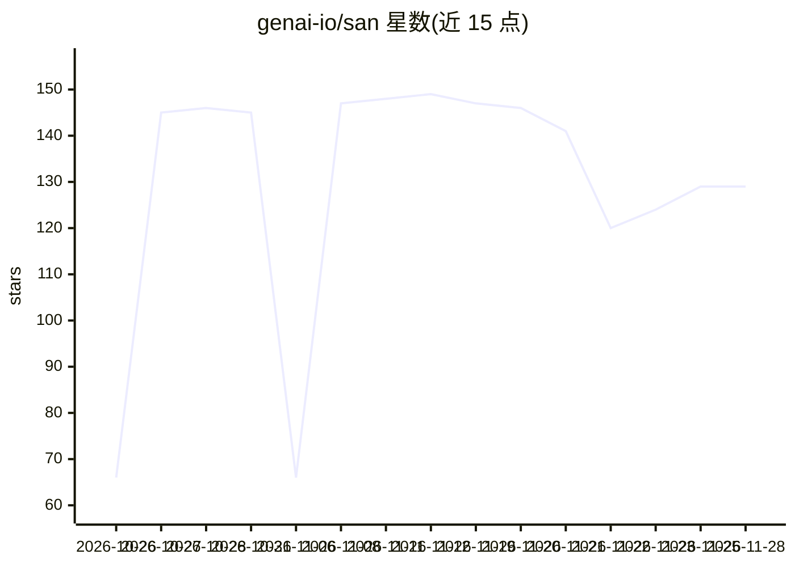

# genai-io/san

⭐ 129 · Go · Apache-2.0 · 推送 2026-11-27 · [GitHub](https://github.com/genai-io/san) · [官网](https://genai-io.github.io/san/) · 个人维护 · 中文 README

**面向终端用户的单二进制终端 AI agent 运行时**

用 Go 编写的终端 agent 运行时，单个原生二进制、无需 Node.js/Python。提供 model-agnostic 的 harness：通过系统提示、personas、skills 和工具塑造 agent 行为，支持子代理、跨会话消息与 Flow 协作蓝图，可配置执行权限并检查模型上下文与工具调用。交互式 TUI、one-shot 与 print 模式，支持会话续接与自动更新。README 含与 Claude Code 的基准测试数据，Apache-2.0 许可。

## 筛选速览

| 维度 | 判定 | 备注 |
|---|---|---|
| AI 角色 | `ai-ecosystem` | LLM/agent 周边工具 |
| 许可风险 | `permissive` | Apache-2.0 |
| 部署形态 | `library` | 以包/库形式分发 |
| 模型依赖 | — | README 未给出锁定关系 |
| 硬件要求 | — | 无带数字的原话,不猜 |
| 安装摩擦 | `low` | 无编译、无系统依赖或容器化 |
| 成熟度 | — | 结构信号不足 |

## 能力要点

- 单个原生 Go 二进制，无需 Node.js 或 Python
- model-agnostic harness：system prompts、personas、skills、tools
- 多代理协调：Subagents、跨会话消息、Flow 协作蓝图
- 执行权限配置与模型上下文/工具调用检查

## 适用场景

- 在终端用自然语言完成编码任务
- 搭建自定义 agent 行为（提示、技能、工具）
- 多子代理协作与跨会话消息传递

## 场景标签

`编码 Agent` · 领域:编码与开发

## 证据(README 行号)

> L23: - **Small and fast** — A single native Go binary with minimal context overhead. No Node.js or Python required.
> L24: - **A less opinionated harness** — A model-agnostic runtime with a consistent interface for shaping agent behavior 
> L30:  *The name — **San**, written **三** ("three") and drawn **☰**. From the Dao De Jing, 三生万物 — "three begets the ten-t

## 星数曲线

2026-10-26 66 → 2026-11-28 129（+63）

---
*卡片 v1 · prompt 1.4 · 生成 2026-11-28 · 置信度 mid · 依据 README sha `68bd375953bb` · [字段定义](../../DATASET.md)*
