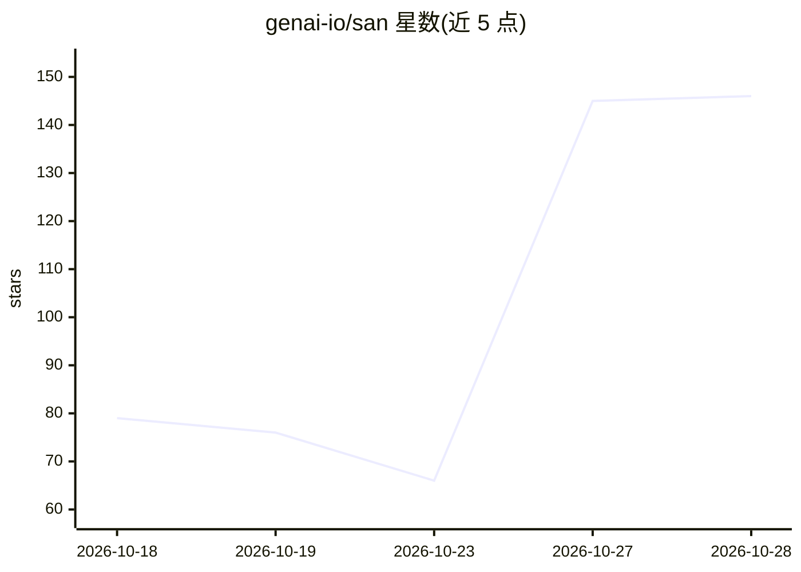

# genai-io/san

⭐ 146 · Go · Apache-2.0 · 推送 2026-10-28 · [GitHub](https://github.com/genai-io/san) · [官网](https://genai-io.github.io/san/) · 组织维护 · 中文 README

**单二进制 Go 终端 agent 运行时，供开发者自托管编码代理**

开源终端 agent 运行时（类似 Claude Code 的 harness），编译为单个约 12 MB 的 Go 二进制，无需 Node.js 或 Python 运行时。提供可插拔模型接入（Anthropic/OpenAI/Google/DeepSeek/Ollama 等十余家）、MCP 服务器、子代理并行、技能与插件扩展；系统提示词、persona、autopilot 目标均为用户可编辑文本。内置 inspector 回放运行记录、权限分级与会话组通信。README 附带与 Claude Code 的体积/启动速度对比基准。

## 筛选速览

| 维度 | 判定 | 备注 |
|---|---|---|
| AI 角色 | `ai-ecosystem` | LLM/agent 周边工具 |
| 许可风险 | `permissive` | Apache-2.0 |
| 部署形态 | `library` | 以包/库形式分发 |
| 模型依赖 | local-ok | 支持本地模型 |
| 硬件要求 | — | 无带数字的原话,不猜 |
| 安装摩擦 | `low` | 无编译、无系统依赖或容器化 |
| 成熟度 | — | 结构信号不足 |

## 能力要点

- 单个 12 MB Go 二进制，~0.01s 冷启动，零运行时依赖
- 支持 15+ 模型提供方（含 Ollama 本地）与 MCP 服务器接入
- 子代理并行编排、会话组互发消息、inspector 运行回放
- 系统提示词/persona/策略自学习均为用户可改文本

## 适用场景

- 在终端中运行可插拔多模型的编码 agent
- 以低上下文开销在 CI 或笔记本上跑自动化 agent 任务
- 并行编排子代理并回放调试运行记录

## 场景标签

`编码 Agent` · 领域:编码与开发

## 证据(README 行号)

> L21: San is an open-source terminal agent runtime: one native Go binary, no Node.js
> L33: **Open** — plug in models, skills, subagents, and MCP servers; write your own system prompt, autopilot goals, and s

## 星数曲线

2026-10-18 79 → 2026-10-28 146（+67）

---
*卡片 v1 · prompt 1.4 · 生成 2026-10-24 · 置信度 high · 依据 README sha `f689c19cb804` · [字段定义](../../DATASET.md)*
