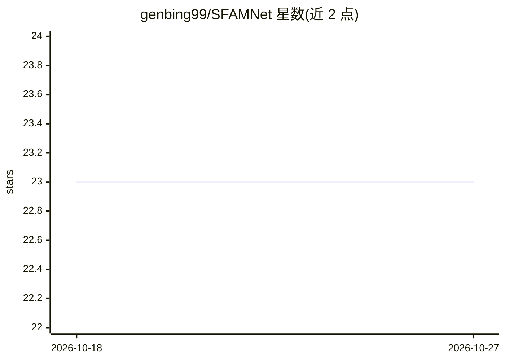

# genbing99/SFAMNet

⭐ 23 · Python · 推送 2025-11-27 · [GitHub](https://github.com/genbing99/SFAMNet) · 组织维护

**基于场景流注意力机制的微表情识别与定位深度学习网络**

论文配套开源代码（发表于 Neurocomputing），实现基于场景流注意力的微表情分析网络，覆盖 spotting（定位）与 recognition（识别）两类任务，支持端到端训练与评估。使用流程：下载预处理数据（README 注明当前暂隐藏）与预训练权重，pip 安装 requirements.txt 依赖，运行 main.py 训练或评估，可配置训练开关与情绪类别数（4/7）。数据为 CASME 数据集的 pkl 格式。限制：processed_data 下载链接当前隐藏。

## 筛选速览

| 维度 | 判定 | 备注 |
|---|---|---|
| AI 角色 | `ai-native` | 本体是模型或模型工具 |
| 许可风险 | `none` | — |
| 部署形态 | `library` | 以包/库形式分发 |
| 模型依赖 | — | README 未给出锁定关系 |
| 硬件要求 | — | 无带数字的原话,不猜 |
| 安装摩擦 | `low` | 无编译、无系统依赖或容器化 |
| 成熟度 | — | 结构信号不足 |

## 能力要点

- 场景流注意力机制处理微表情 spotting 与 recognition
- 提供预训练权重与训练/评估脚本（main.py）
- 支持 4/7 类情绪设置切换

## 适用场景

- 复现微表情识别与定位的论文结果
- 在 CASME 数据集上训练微表情分析模型

## 场景标签

 · 领域:计算机视觉/情感计算

## 证据(README 行号)

> L1: # SFAMNet: A Scene Flow Attention-based Micro-expression Network
> L8: Performance comparison for micro-expression spotting .
> L10: Performance comparison for micro-expression recognition .

## 星数曲线

2026-10-18 23 → 2026-10-27 23（+0）

---
*卡片 v1 · prompt 1.4 · 生成 2026-10-27 · 置信度 low · 依据 README sha `2f518f4a1588` · [字段定义](../../DATASET.md)*
