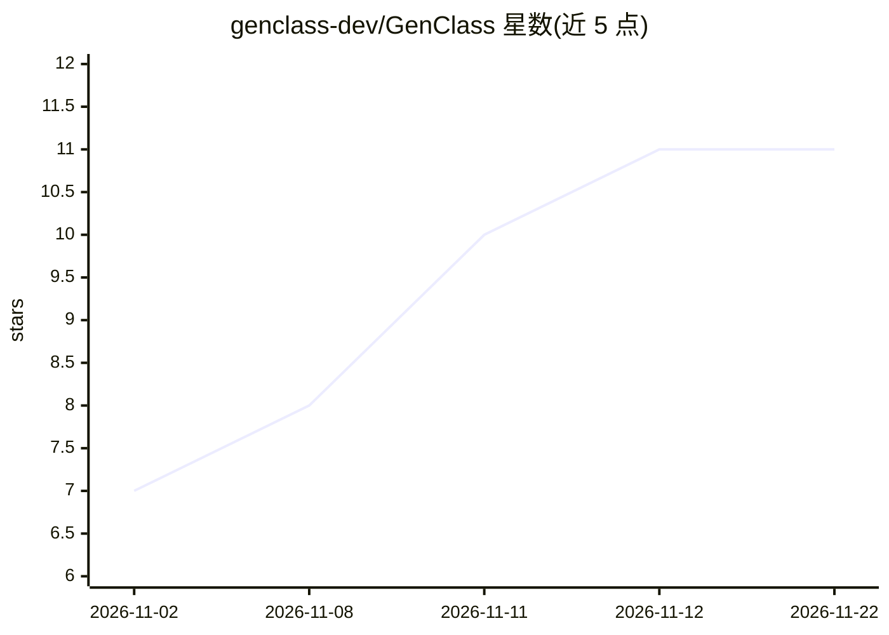

# genclass-dev/GenClass

⭐ 11 · TypeScript · Apache-2.0 · 推送 2026-11-21 · [GitHub](https://github.com/genclass-dev/GenClass) · [官网](https://genclass.dev) · 组织维护

**浏览器内 10MB 模型：检测 Web 应用竞态与陈旧响应**

浏览器端库（Apache-2.0），在 Web Worker 中经 WebGPU 或 WASM 运行约 10MB 的本地模型，实时报告 Web 应用中的竞态问题：陈旧响应覆盖新数据、重复请求（如重复提交）、状态不一致与失败风暴，每条报告附带证据。默认 observe 模式只报告不干预；guard 为可选干预模式，heal 为实验性。支持 React/Next.js/Vue/SvelteKit/Angular/Solid/纯 HTML。Pro 订阅（试用 3 天后每月 50 美元/开发者）提供 CLI、dashboard 与 agent 集成；免费层仅限网站功能。

## 筛选速览

| 维度 | 判定 | 备注 |
|---|---|---|
| AI 角色 | `ai-ecosystem` | LLM/agent 周边工具 |
| 许可风险 | `permissive` | Apache-2.0 |
| 部署形态 | `library` | 以包/库形式分发 |
| 模型依赖 | — | README 未给出锁定关系 |
| 硬件要求 | — | 无带数字的原话,不猜 |
| 安装摩擦 | `medium` | 含编译或系统依赖之一 |
| 成熟度 | `idea` | |

## 能力要点

- 设备端模型（WebGPU/WASM Web Worker）检测竞态、陈旧响应、重复请求
- 默认 observe 模式只报告，不持有、延迟或修改请求/响应/状态写入
- @genclass/mcp MCP 服务器向 Claude Code 等编码 agent 提供点击/请求/检测数据并生成 Playwright 测试
- 提供 npx CLI（init/dashboard/suggest/scan）与可视化检查

## 适用场景

- 检测 Web 应用中的双击重复提交与响应乱序竞态
- 让编码 agent 复现时序相关 bug 并生成回归测试
- 无侵入审计任意页面的可视化/CSS 缺陷

## 场景标签

`代码审查` · 领域:编码与开发

## 证据(README 行号)

> L11: **GenClass Runtime (`@genclass/runtime`) is an open-source (Apache-2.0) browser library that reports race condition
> L13: inconsistent state and failure storms.** A small model runs on the user's device, in a Web Worker on WebGPU or WASM
> L172: `@genclass/mcp` (`0.2.0`, on npm since 2026-10-25) is an MCP server for Claude Code and other coding agents. Your

## 星数曲线

2026-11-02 7 → 2026-11-22 11（+4）

---
*卡片 v1 · prompt 1.4 · 生成 2026-11-18 · 置信度 high · 依据 README sha `c22e4eabe95c` · [字段定义](../../DATASET.md)*
