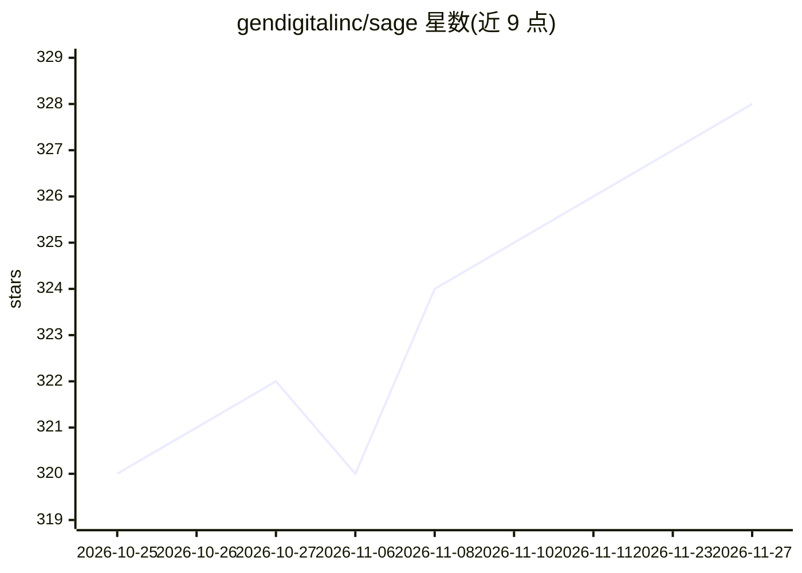

# gendigitalinc/sage

⭐ 328 · TypeScript · Apache-2.0 · 推送 2026-11-09 · [GitHub](https://github.com/gendigitalinc/sage) · [官网](https://ai.gendigital.com/sage) · 组织维护

**为 AI 编码助手提供命令、文件、网页请求的安全防护层**

Sage 是嵌入 AI agent 工具调用链路的安全层：拦截 shell 命令、URL 抓取、文件写入等工具调用，经多层威胁检测后再放行。检测机制包括云端 URL 信誉、300+ 条 YAML 本地启发式规则、双层（启发式+微调 ML 模型）提示注入检测、npm/PyPI 供应链检查、会话启动时插件扫描，以及 Windows AMSI 集成。以插件/扩展形式接入 Claude Code、Cursor、VS Code、OpenClaw、OpenCode 等宿主，属 Gen Digital 的 Gen Agent Trust Hub 产品线，不同安装渠道下可能以其他品牌名出现。

## 筛选速览

| 维度 | 判定 | 备注 |
|---|---|---|
| AI 角色 | `ai-ecosystem` | LLM/agent 周边工具 |
| 许可风险 | `permissive` | Apache-2.0 |
| 部署形态 | `library` | 以包/库形式分发 |
| 模型依赖 | locked-api |  |
| 硬件要求 | — | 无带数字的原话,不猜 |
| 安装摩擦 | `low` | 无编译、无系统依赖或容器化 |
| 成熟度 | — | 结构信号不足 |

## 能力要点

- 拦截并检测 agent 工具调用（命令/URL/文件写入）
- 300+ YAML 本地威胁规则与云端 URL 信誉检测
- 启发式+微调 ML 模型的双层提示注入检测
- npm/PyPI 供应链检查与会话启动插件扫描

## 适用场景

- 防止 Claude Code 等 agent 执行危险 shell 命令
- 扫描 agent 抓取网页内容中的注入指令
- 检查 AI 建议安装的 npm/PyPI 包的供应链风险

## 场景标签

`网络安全` · 领域:学习与行业

## 证据(README 行号)

> L9: Sage is a lightweight security layer that protects AI agents from executing dangerous actions. It intercepts tool ca
> L74: |Host|Package|How it hooks|
> L79: |Cursor / VS Code / Copilot CLI|`sage-cursor`|Installed hook script|

## 星数曲线

2026-10-25 320 → 2026-11-27 328（+8）

---
*卡片 v1 · prompt 1.4 · 生成 2026-11-25 · 置信度 mid · 依据 README sha `09042263298f` · [字段定义](../../DATASET.md)*
