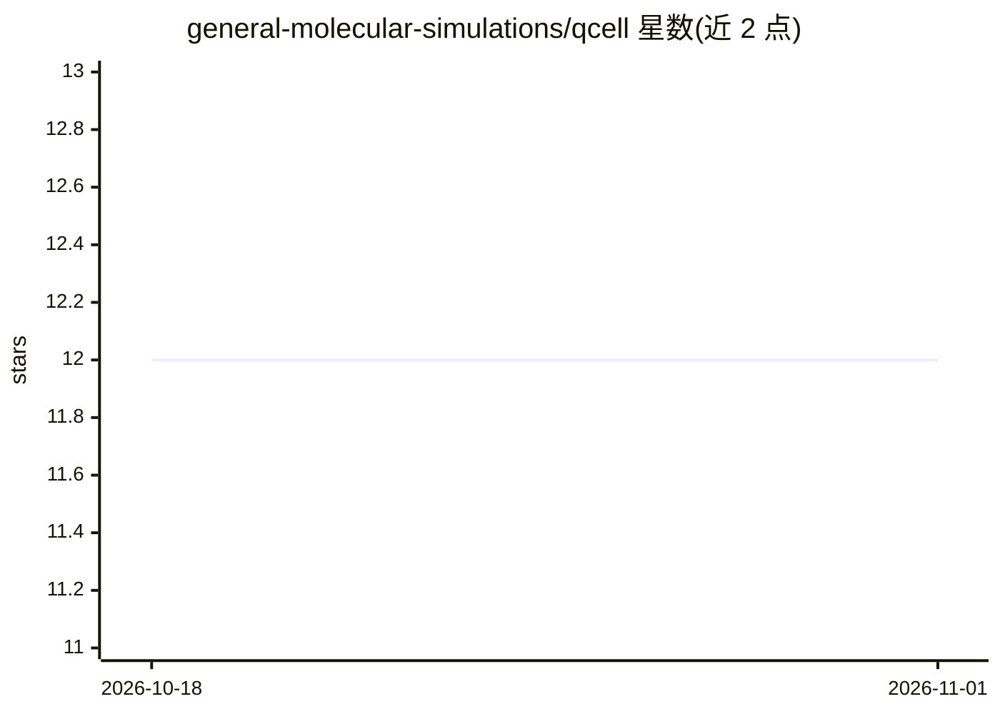

# general-molecular-simulations/qcell

⭐ 12 · Python · MIT · 推送 2026-10-16 · [GitHub](https://github.com/general-molecular-simulations/qcell) · [官网](https://doi.org/10.1088/3050-287X/ae5267) · 组织维护

**面向生物分子的量子力学数据集：训练与基准测试机器学习力场**

QCell 收录 525,881 个量子力学计算结果，覆盖核酸、脂质、碳水化合物片段以及二聚体和离子–水簇，全部在 PBE0+MBD(-NL) 理论水平计算。数据集定位为训练和基准测试机器学习力场的资源，可从 Zenodo 以 .h5 或 .xyz 格式下载。仓库 scripts/ 目录提供构象生成工作流，各子目录含说明数据构建与采样协议的 README。数据覆盖 20 种元素、体系规模 2–402 个原子。

## 筛选速览

| 维度 | 判定 | 备注 |
|---|---|---|
| AI 角色 | `ai-knowledge` | 知识聚合/清单类 |
| 许可风险 | `permissive` | MIT |
| 部署形态 | `None` |  |
| 模型依赖 | — | README 未给出锁定关系 |
| 硬件要求 | — | 无带数字的原话,不猜 |
| 安装摩擦 | `low` | 无编译、无系统依赖或容器化 |
| 成熟度 | — | 结构信号不足 |

## 能力要点

- 525,881 个量子力学计算，PBE0+MBD(-NL) 理论水平
- 覆盖核酸、脂质、碳水化合物片段及二聚体、离子–水簇
- 数据可从 Zenodo 以 .h5 或 .xyz 格式下载
- scripts/ 目录提供构象生成工作流

## 适用场景

- 我需要训练机器学习力场时获取量子力学参考数据
- 我要对力场方法在生物分子片段上做基准测试
- 我研究核酸、脂质、碳水化合物等体系的分子相互作用

## 场景标签

`模型评测` · 领域:评测与运维

## 证据(README 行号)

> L3: QCell is a collection of 525k quantum-mechanical calculations for (bio)molecular systems that go beyond small molecu
> L5: The data can be downloaded from the Zenodo repository in `.h5` or `.xyz` format. This repository provides conformer 

## 星数曲线

2026-10-18 12 → 2026-11-01 12（+0）

---
*卡片 v1 · prompt 1.4 · 生成 2026-11-01 · 置信度 high · 依据 README sha `36ae7eaef93a` · [字段定义](../../DATASET.md)*
