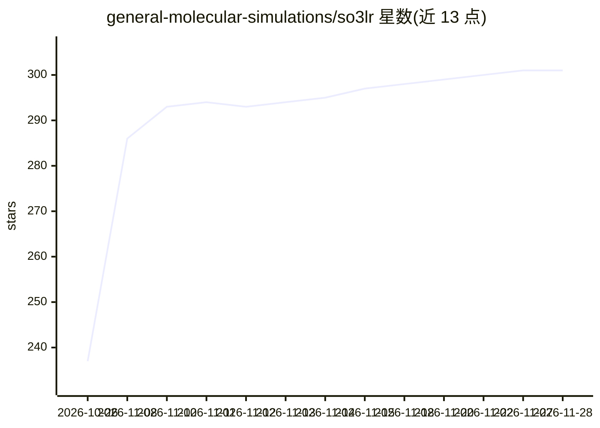

# general-molecular-simulations/so3lr

⭐ 301 · Python · MIT · 推送 2026-11-24 · [GitHub](https://github.com/general-molecular-simulations/so3lr) · [官网](https://arxiv.org/abs/2611.06237) · 组织维护

**面向科研者的机器学习力场库，用于反应性（生物）分子模拟**

SO3LR 是预训练的机器学习力场，结合 SO3krates 神经网络与通用对势力场（短程排斥、长程静电与色散），覆盖元素 H 到 At（Z=1–85）。提供命令行工具做几何优化、分子动力学和评估，也可作为 ASE calculator 在 Python 中调用；支持周期性体系的 PME 长程静电，模型随包内置并按名称选择，另有微调与从头训练能力。通过 uv/源码安装，CPU 或 GPU（CUDA/ROCm）均可运行，并提供网页版与 Colab 免安装试用。

## 筛选速览

| 维度 | 判定 | 备注 |
|---|---|---|
| AI 角色 | `ai-native` | 本体是模型或模型工具 |
| 许可风险 | `permissive` | MIT |
| 部署形态 | `library` | 以包/库形式分发 |
| 模型依赖 | — | README 未给出锁定关系 |
| 硬件要求 | — | 无带数字的原话,不猜 |
| 安装摩擦 | `medium` | 含编译或系统依赖之一 |
| 成熟度 | — | 结构信号不足 |

## 能力要点

- 预训练力场覆盖 H 到 At（Z=1–85），支持反应性模拟
- CLI 提供几何优化、分子动力学与评估命令
- 可作为 ASE calculator 集成到 Python 工作流
- 周期性体系支持 Ewald/PME/P3M 长程静电

## 适用场景

- 对生物分子体系跑分子动力学模拟
- 优化分子几何结构并评估能量与梯度
- 在自有数据上微调或从头训练力场模型
- 结合 PySAGES 做增强采样模拟

## 场景标签

`科研工具` `微调` `模型训练` · 领域:学习与行业

## 证据(README 行号)

> L13: SO3LR - pronounced *Solar* - is a pretrained machine-learned force field for
> L49: SO3LR provides a command-line interface for geometry optimization, molecular
> L63: To use SO3LR as an ASE calculator:

## 星数曲线

2026-10-26 237 → 2026-11-28 301（+64）

---
*卡片 v1 · prompt 1.4 · 生成 2026-11-25 · 置信度 high · 依据 README sha `9137e751c06d` · [字段定义](../../DATASET.md)*
