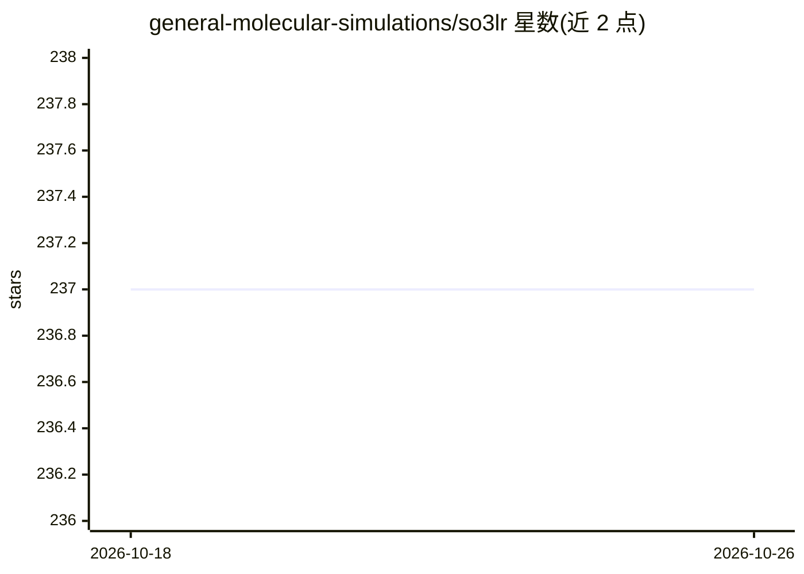

# general-molecular-simulations/so3lr

⭐ 237 · Python · MIT · 推送 2026-04-17 · [GitHub](https://github.com/general-molecular-simulations/so3lr) · [官网](https://doi.org/10.1021/jacs.5c09558) · 组织维护

**预训练机器学习力场：用于生物分子模拟的能量与力预测**

SO3LR 是面向(生物)分子模拟的预训练机器学习力场，结合 SO3krates 神经网络处理半局部相互作用与通用成对力场（短程排斥、长程静电与色散）。基于 JAX 实现，支持 CPU 与 GPU 运行，提供统一 CLI 执行几何优化、NVT/NPT/NVE 分子动力学、模型评测与微调（微调为实验性），并以 ASE calculator 和 So3lrPotential 接口供 Python 集成。限制：模型未在能量上训练，仅相对能量有意义。

## 筛选速览

| 维度 | 判定 | 备注 |
|---|---|---|
| AI 角色 | `ai-native` | 本体是模型或模型工具 |
| 许可风险 | `permissive` | MIT |
| 部署形态 | `library` | 以包/库形式分发 |
| 模型依赖 | — | README 未给出锁定关系 |
| 硬件要求 | — | 无带数字的原话,不猜 |
| 安装摩擦 | `low` | 无编译、无系统依赖或容器化 |
| 成熟度 | `idea` | |

## 能力要点

- SO3krates 神经网络 + 通用成对力场的组合力场
- CLI 支持几何优化、NVT/NPT/NVE 模拟、评测与微调，支持检查点重启
- 提供 ASE calculator 与 So3lrPotential（兼容 jax.jit/vmap/grad）接口
- 基于 JAX/JAX-MD，支持 CPU 与 GPU

## 适用场景

- 对分子体系做几何优化与分子动力学模拟
- 在自定义数据集上评测或微调力场模型
- 通过 ASE calculator 或 JAX 接口将力场集成到自己的 MD 代码
- 计算二聚体结合能

## 场景标签

 · 领域:计算化学/分子模拟

## 证据(README 行号)

> L10: SO3LR - pronounced *Solar* - is a pretrained machine-learned force field for (bio)molecular simulations. It integra
> L40: SO3LR provides a unified command-line interface that leverages the performance of JAX-MD under the hood (detailed i

## 星数曲线

2026-10-18 237 → 2026-10-26 237（+0）

---
*卡片 v1 · prompt 1.4 · 生成 2026-10-22 · 置信度 high · 依据 README sha `6dfe195c28ab` · [字段定义](../../DATASET.md)*
