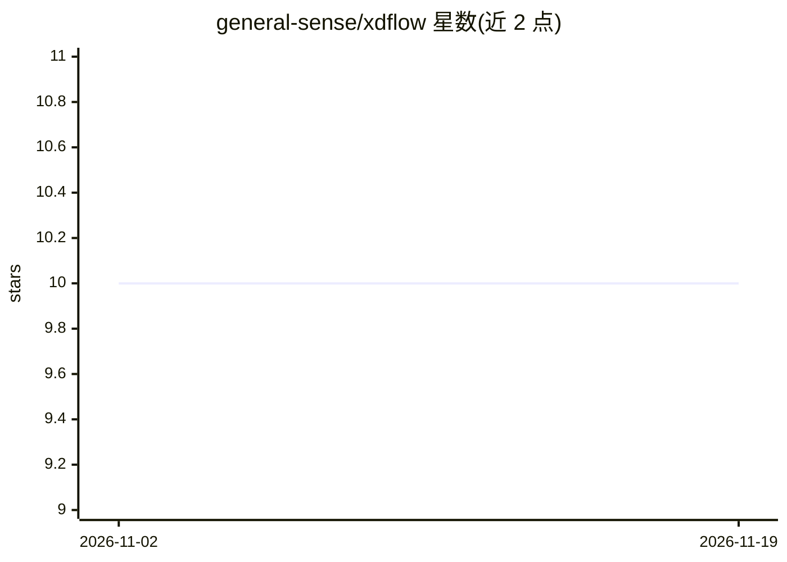

# general-sense/xdflow

⭐ 10 · Python · MIT · 推送 2026-11-02 · [GitHub](https://github.com/general-sense/xdflow) · [官网](https://xdflow.readthedocs.io) · 个人维护

**面向科研结构化实验数据的元数据驱动 ML 流水线库**

构建在 xarray 之上的机器学习流水线库：trial、channel、subject、session 等维度与坐标随数据贯穿预处理、拟合、交叉验证、调参与预测，scikit-learn 估计器可直接接入。核心机制是自动在第一个会学习的步骤前切分流水线，防止数据泄漏，并对共享部分做缓存以加速交叉验证与调参。提供按坐标划分折、命名寻址维度、泄漏检查、Optuna 调参及与 MNE、MOABB、LightGBM 等互操作。面向处理有结构实验数据（如 EEG、可穿戴传感）的科研用户，要求 Python 3.11+。

## 筛选速览

| 维度 | 判定 | 备注 |
|---|---|---|
| AI 角色 | `ai-native` | 本体是模型或模型工具 |
| 许可风险 | `permissive` | MIT |
| 部署形态 | `library` | 以包/库形式分发 |
| 模型依赖 | — | README 未给出锁定关系 |
| 硬件要求 | — | 无带数字的原话,不猜 |
| 安装摩擦 | `low` | 无编译、无系统依赖或容器化 |
| 成熟度 | — | 结构信号不足 |

## 能力要点

- 基于 xarray 的元数据随数据流转，支持按 subject/session 划分交叉验证折
- 自动在首个学习步骤前切分流水线，避免交叉验证数据泄漏
- 共享预处理部分缓存复用，README 给出与 scikit-learn 缓存流水线的基准对比
- 提供 MNE epochs 导入、to_sklearn 转换及 Optuna/MLflow 调参跟踪

## 适用场景

- 对 EEG 运动想象等数据做被试内/跨被试解码并控制泄漏
- 对带被试分组的活动识别数据做正确分组的交叉验证
- 为已有 scikit-learn 流水线加速特征提取与超参搜索
- 检查现有数据划分是否存在被试信息泄漏

## 场景标签

`科研工具` `MLOps` · 领域:学习与行业

## 证据(README 行号)

> L12: `xdflow` keeps that structure in the data. It is built on xarray, so dimensions and
> L244:  existing `Pipeline` runs as is in `evaluate`, and `to_sklearn` turns an xdflow pipeline into a scikit-learn

## 星数曲线

2026-11-02 10 → 2026-11-19 10（+0）

---
*卡片 v1 · prompt 1.4 · 生成 2026-11-19 · 置信度 high · 依据 README sha `753a9df85a73` · [字段定义](../../DATASET.md)*
