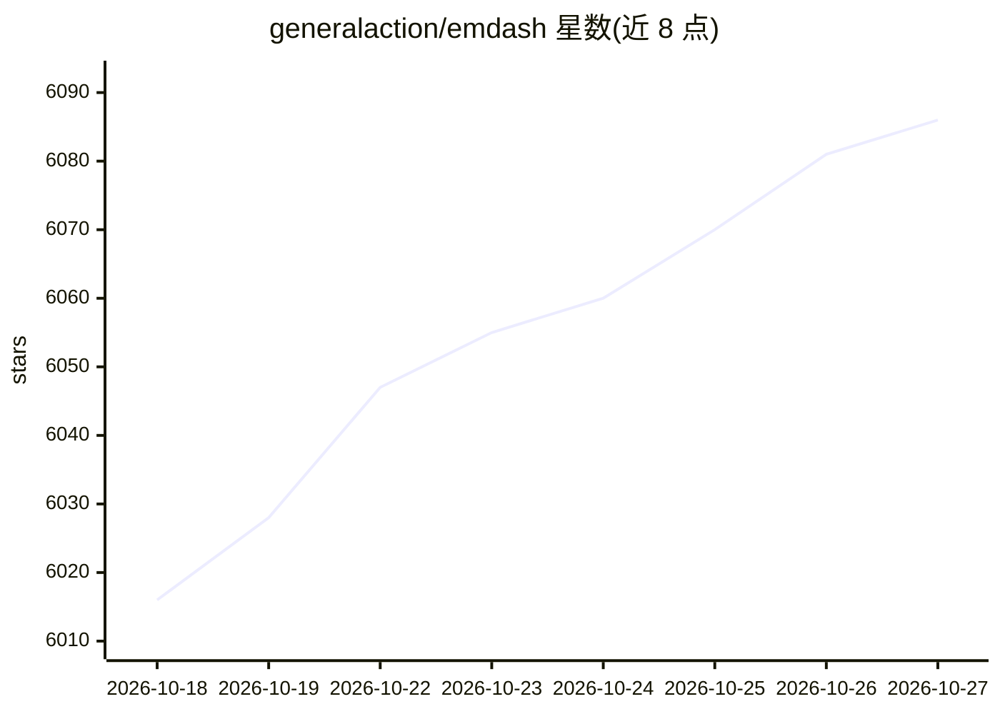

# generalaction/emdash

⭐ 6,086 · TypeScript · Apache-2.0 · 推送 2026-10-26 · [GitHub](https://github.com/generalaction/emdash) · [官网](https://emdash.com) · 组织维护

**并行运行多个 AI 编码代理的桌面开发环境**

桌面应用，用于并行运行多个 AI 编码代理 CLI（Claude Code、Codex、OpenCode、Amp、Qwen Code 等），自动检测已安装的代理。每个任务运行在独立的 Git worktree 与分支中，支持审查 diff、创建 PR、查看 CI 并合并。可从 Linear、GitHub、Jira、GitLab、Asana 等十余个来源发送工单给代理。支持本地项目与 SSH/SFTP 远程机器；本地优先，状态存于 SQLite，不向 Emdash 服务器发送代码。提供 macOS（brew/安装包）、Windows、Linux 多架构桌面构建，遥测可关闭。

## 筛选速览

| 维度 | 判定 | 备注 |
|---|---|---|
| AI 角色 | `ai-ecosystem` | LLM/agent 周边工具 |
| 许可风险 | `permissive` | Apache-2.0 |
| 部署形态 | `None` |  |
| 模型依赖 | — | README 未给出锁定关系 |
| 硬件要求 | — | 无带数字的原话,不猜 |
| 安装摩擦 | `low` | 无编译、无系统依赖或容器化 |
| 成熟度 | — | 结构信号不足 |

## 能力要点

- 每个代理任务隔离在独立 Git worktree 与分支中运行
- 自动检测已安装的代理 CLI，通过生命周期钩子追踪状态与会话
- 接入 Linear/GitHub/Jira/GitLab/Asana 等工单来源
- 本地优先：状态存 SQLite，代码与对话不上传 Emdash 服务器，遥测可选

## 适用场景

- 同时探索多个修复或功能方案，对比 diff 后合并可行结果
- 把工单系统里的 issue 直接交给编码代理处理
- 在远程机器上通过 SSH 运行同样的并行代理工作流

## 场景标签

`编码 Agent` · 领域:编码与开发

## 证据(README 行号)

> L15: Emdash is a desktop app for running AI coding agents in parallel. Each task runs in its
> L47: Emdash detects installed provider CLIs automatically. It supports agents like Claude

## 星数曲线

2026-10-18 6,016 → 2026-10-27 6,086（+70）

---
*卡片 v1 · prompt 1.4 · 生成 2026-10-20 · 置信度 high · 依据 README sha `12f4dba3e245` · [字段定义](../../DATASET.md)*
