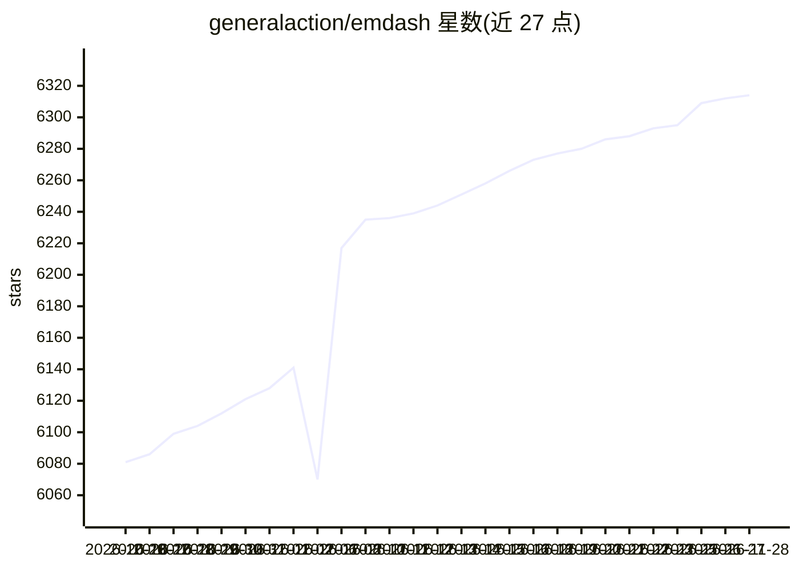

# generalaction/emdash

⭐ 6,314 · TypeScript · Apache-2.0 · 推送 2026-11-23 · [GitHub](https://github.com/generalaction/emdash) · [官网](https://emdash.com/classic) · 组织维护

**并行运行编码 Agent 的开源桌面应用：worktree 隔离**

Emdash Classic 是运行编码 Agent 的开源桌面应用，覆盖 macOS/Windows/Linux。核心机制：每个 Agent 运行在独立的 Git worktree 与分支中实现隔离，可同时运行多个 Agent；自动检测本机已安装的 provider CLI（如 Claude Code、Codex、Cursor 等）；可从 Linear、GitHub、Jira 等系统将 issue 发送给 Agent；支持 SSH/SFTP 连接远程机器执行相同工作流；应用内完成 diff 审查、PR 创建、CI 检查与合并。本地优先，状态存于本地 SQLite，遥测可关闭。

## 筛选速览

| 维度 | 判定 | 备注 |
|---|---|---|
| AI 角色 | `ai-ecosystem` | LLM/agent 周边工具 |
| 许可风险 | `permissive` | Apache-2.0 |
| 部署形态 | `None` |  |
| 模型依赖 | — | README 未给出锁定关系 |
| 硬件要求 | — | 无带数字的原话,不猜 |
| 安装摩擦 | `low` | 无编译、无系统依赖或容器化 |
| 成熟度 | — | 结构信号不足 |

## 能力要点

- 多编码 Agent 并行运行，各自隔离在独立 Git worktree 与分支
- 自动检测已安装的 provider CLI（Claude Code、Codex、Cursor 等）
- 从 Linear/GitHub/Jira/GitLab 等系统发送 issue/ticket 给 Agent
- SSH/SFTP 远程机器上运行相同并行工作流，凭据存于 OS 钥匙串

## 适用场景

- 同时跑多个编码 Agent 处理不同任务而不开多个终端
- 把 Linear/Jira 工单直接交给 Agent 处理
- 在远程服务器代码库上运行并行 Agent 工作流
- 在一个应用内审查 diff、开 PR、看 CI 并合并

## 场景标签

`编码 Agent` · 领域:编码与开发

## 证据(README 行号)

> L3: Emdash Classic is the open-source desktop app for running coding agents in parallel. Run Claude Code, Codex, OpenCod
> L42: The app automatically detects installed provider CLIs, including Claude Code, Codex, Cursor,

## 星数曲线

2026-10-26 6,081 → 2026-11-28 6,314（+233）

---
*卡片 v1 · prompt 1.4 · 生成 2026-11-22 · 置信度 high · 依据 README sha `b1eb9f2ccdff` · [字段定义](../../DATASET.md)*
