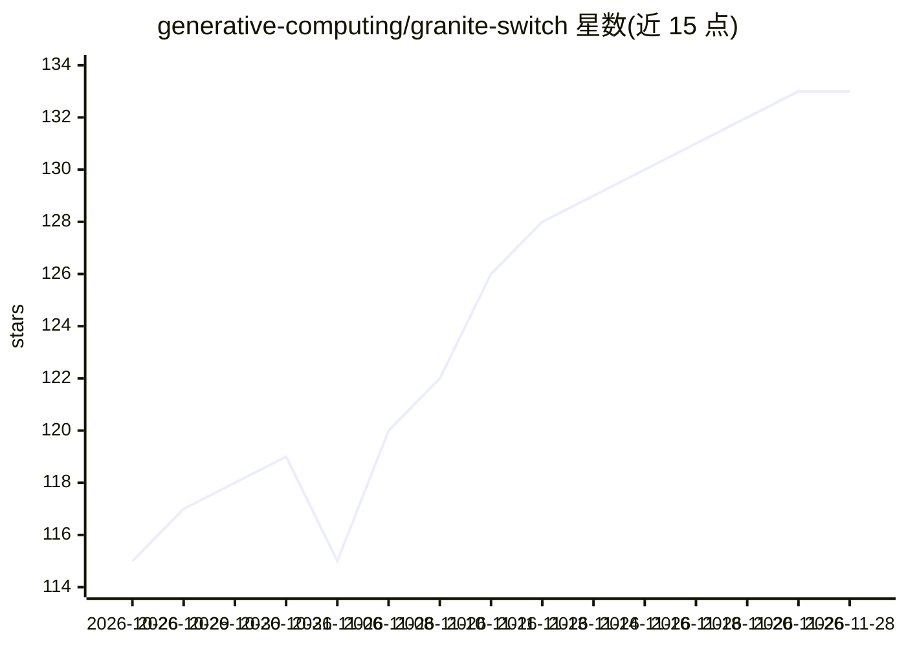

# generative-computing/granite-switch

⭐ 133 · Python · Apache-2.0 · 推送 2026-11-22 · [GitHub](https://github.com/generative-computing/granite-switch) · [官网](https://huggingface.co/ibm-granite/granite-switch-4.1-3b-preview) · 组织维护

**面向 AI 开发者的 LoRA 适配器函数组合与部署工具链**

将 LoRA 适配器函数（RAG、安全、事实性等 12 个）以类似软件库依赖的方式组合进 Granite 基座模型，产出单一可部署 checkpoint。基于 Activated LoRA（aLoRA）技术，所有适配器共享同一 KV cache，通过控制令牌按需激活，部署后无额外显存与延迟开销。支持 vLLM 生产部署与 HuggingFace 原型推理，同一 checkpoint 无需转换。提供 composer 命令行与预组合模型。要求 Python 3.11+、PyTorch 2.11+（CUDA 13+）。

## 筛选速览

| 维度 | 判定 | 备注 |
|---|---|---|
| AI 角色 | `ai-ecosystem` | LLM/agent 周边工具 |
| 许可风险 | `permissive` | Apache-2.0 |
| 部署形态 | `library` | 以包/库形式分发 |
| 模型依赖 | local-ok | 支持本地模型 |
| 硬件要求 | — | 无带数字的原话,不猜 |
| 安装摩擦 | `medium` | 含编译或系统依赖之一 |
| 成熟度 | — | 结构信号不足 |

## 能力要点

- 适配器函数带输入/输出契约，由 Mellea 在 token 层强制 schema
- aLoRA 共享 KV cache，多适配器按需激活，无显存/延迟开销
- pip 一条命令组合 checkpoint，兼容 HuggingFace 与 vLLM
- 提供 3B/8B/30B 预组合模型与 Colab 教程

## 适用场景

- 把 RAG、安全审查等适配器函数打包成一个可部署模型
- 按需替换或升级单个适配器而无需重训整个模型
- 用小模型加适配器在目标任务上替代大模型部署

## 场景标签

`推理引擎` · 领域:训练与推理

## 证据(README 行号)

> L11: Software is built from libraries — you pick the ones you need, compose them, and ship. Granite Switch brings this t
> L133: - **Granite Switch** (this repo) — The model architecture and composer toolchain for embedding adapter functions i

## 星数曲线

2026-10-26 115 → 2026-11-28 133（+18）

---
*卡片 v1 · prompt 1.4 · 生成 2026-11-28 · 置信度 high · 依据 README sha `b92def8881f0` · [字段定义](../../DATASET.md)*
