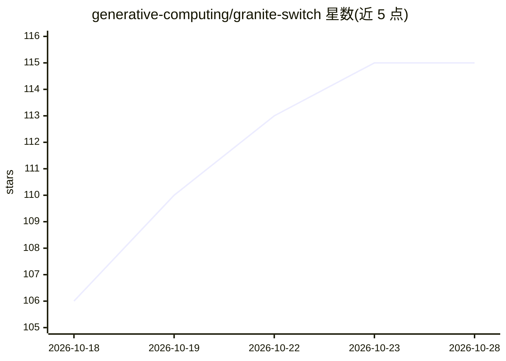

# generative-computing/granite-switch

⭐ 117 · Python · Apache-2.0 · 推送 2026-10-28 · [GitHub](https://github.com/generative-computing/granite-switch) · [官网](https://huggingface.co/ibm-granite/granite-switch-4.1-3b-preview) · 组织维护

**把可组合 LoRA 适配函数组装进单一模型的架构与作曲工具链**

面向开发者的模型组装工具链：将针对 RAG、安全、事实性等任务训练的 adapter function（带明确输入/输出契约的 LoRA 适配器）组合进 Granite 基座模型，生成单一可部署 checkpoint，可用 vLLM 或 HuggingFace 直接推理。核心机制是 IBM 的 Activated LoRA（aLoRA）：所有适配函数共享同一归一化 KV 缓存，靠控制 token 按需激活，切换无缓存重算。也提供 3B/8B/30B 预组装模型。需 Python 3.11+、PyTorch 2.11+、CUDA 13+。

## 筛选速览

| 维度 | 判定 | 备注 |
|---|---|---|
| AI 角色 | `ai-ecosystem` | LLM/agent 周边工具 |
| 许可风险 | `permissive` | Apache-2.0 |
| 部署形态 | `library` | 以包/库形式分发 |
| 模型依赖 | local-ok | 支持本地模型 |
| 硬件要求 | — | 无带数字的原话,不猜 |
| 安装摩擦 | `medium` | 含编译或系统依赖之一 |
| 成熟度 | `idea` | |

## 能力要点

- adapter function 可独立开发、替换、组合进单一 checkpoint，无需联合训练
- Activated LoRA 共享 KV 缓存，控制 token 触发按需激活
- 同一 checkpoint 兼容 vLLM 生产部署与 HuggingFace 原型验证，无需转换
- 提供预组装模型（3B/8B/30B）与 Colab 教程笔记本

## 适用场景

- 把 RAG、安全审查等适配能力组合进一个小模型部署
- 独立升级某个适配函数而不重训整个模型
- 用 vLLM 部署多能力合一的模型服务

## 场景标签

 · 领域:LLM 基础设施/模型工程

## 证据(README 行号)

> L11: Software is built from libraries — you pick the ones you need, compose them, and ship. Granite Switch brings this t
> L133: - **Granite Switch** (this repo) — The model architecture and composer toolchain for embedding adapter functions i

## 星数曲线

2026-10-18 106 → 2026-10-28 115（+9）

---
*卡片 v1 · prompt 1.4 · 生成 2026-10-23 · 置信度 high · 依据 README sha `23f7a9e880ab` · [字段定义](../../DATASET.md)*
