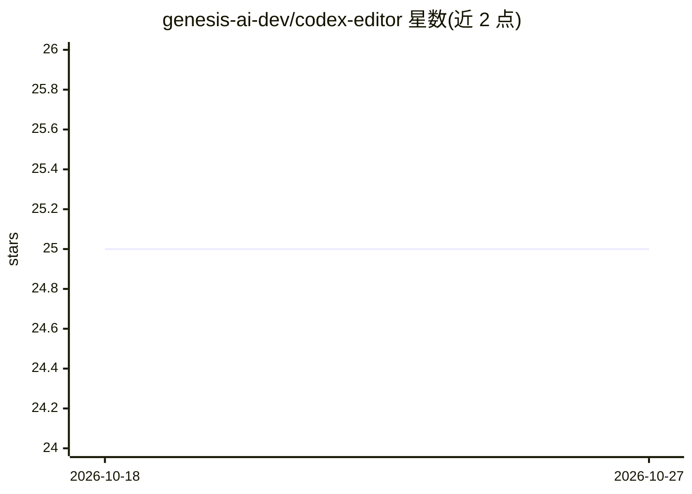

# genesis-ai-dev/codex-editor

⭐ 25 · TypeScript · MIT · 推送 2026-10-13 · [GitHub](https://github.com/genesis-ai-dev/codex-editor) · [官网](https://codexeditor.app) · 组织维护

**面向圣经翻译项目的 VS Code 扩展，带 AI 辅助起草**

Visual Studio Code 扩展，面向圣经翻译工作流：支持 .codex 笔记本、.scripture 与 .bible 文件的语法高亮与编辑，集成 Translator's Copilot Language Server 提供起草与诊断，含资源浏览、经文检索、评论管理等自定义视图与命令。AI 部分（聊天与 LLM 起草建议）默认使用 LM Studio 本地服务端，也可配置 OpenAI API。安装途径为 VS Code Marketplace 或源码克隆后 pnpm/npm 构建运行。声明处于活跃开发中，可能存在缺陷或不完整功能。

## 筛选速览

| 维度 | 判定 | 备注 |
|---|---|---|
| AI 角色 | `ai-enhanced` | 去掉 AI 部分产品仍成立 |
| 许可风险 | `permissive` | MIT |
| 部署形态 | `library` | 以包/库形式分发 |
| 模型依赖 | — | README 未给出锁定关系 |
| 硬件要求 | — | 无带数字的原话,不猜 |
| 安装摩擦 | `low` | 无编译、无系统依赖或容器化 |
| 成熟度 | `idea` | |

## 能力要点

- 支持 .codex 笔记本与 .scripture 文件的语法高亮与语言支持
- 集成 Translator's Copilot Language Server 做起草与诊断
- LLM 起草建议默认走 LM Studio 本地服务端，可选 OpenAI API
- 提供 Genesis Translator、Scripture Explorer 等自定义视图与命令面板命令

## 适用场景

- 在 VS Code 中组织和管理圣经翻译项目
- 借助 AI 起草建议与诊断辅助经文翻译
- 对照检索经文段落与管理翻译评论

## 场景标签

`AI 写作` · 领域:内容生成

## 证据(README 行号)

> L3: The Codex Translation Editor Extension is a powerful Visual Studio Code extension designed to enhance the experience
> L27: > Note: If you are using the Translator's Copilot AI chat or the LLM-powered drafting suggestions, you will need to

## 星数曲线

2026-10-18 25 → 2026-10-27 25（+0）

---
*卡片 v1 · prompt 1.4 · 生成 2026-10-27 · 置信度 high · 依据 README sha `c5fe049a591b` · [字段定义](../../DATASET.md)*
