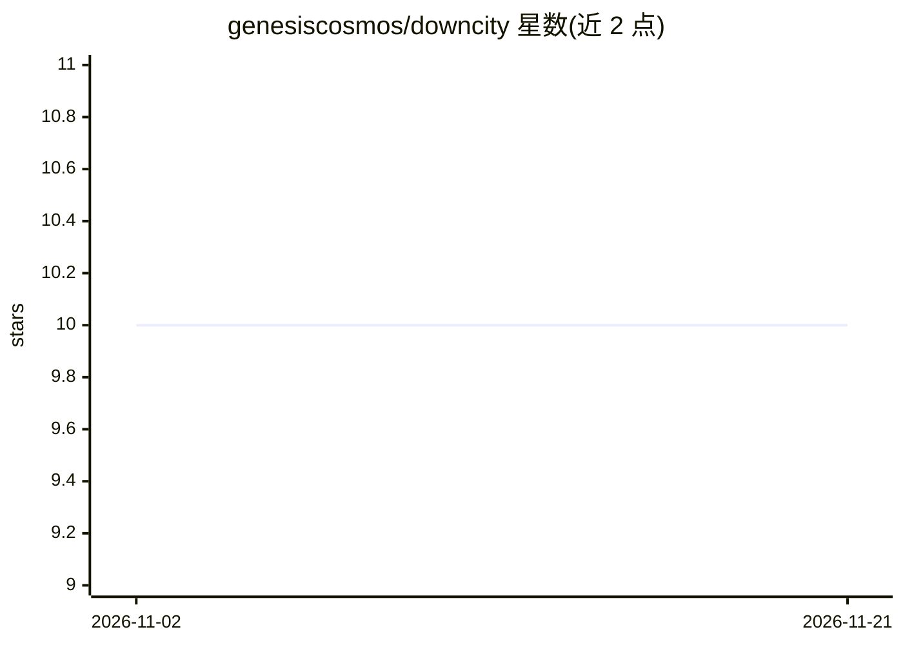

# genesiscosmos/downcity

⭐ 10 · TypeScript · Apache-2.0 · 推送 2026-11-18 · [GitHub](https://github.com/genesiscosmos/downcity) · [官网](https://downcity.ai) · 组织维护 · 中文 README

**给 AI 开发者的 Agent 基础设施运行时：统一管理多个 Agent**

面向需要交付多个 agent 产品的创作者、独立开发者与团队的可复用运行时层，聚合 Agent 运行、模型、工具、任务、记忆、插件、权限、用量与计费等后端能力，避免每个新产品重复搭建 agent 后端。以 CLI（downcity/city、fed）加多个 SDK 包形式提供：本地 City 托管 Agent 守护进程，Federation 统一账号、余额、用量、支付与服务路由，Workspace 通过 microsandbox 微虚拟机提供隔离沙箱执行 Shell。

## 筛选速览

| 维度 | 判定 | 备注 |
|---|---|---|
| AI 角色 | `ai-ecosystem` | LLM/agent 周边工具 |
| 许可风险 | `permissive` | Apache-2.0 |
| 部署形态 | `library` | 以包/库形式分发 |
| 模型依赖 | — | README 未给出锁定关系 |
| 硬件要求 | — | 无带数字的原话,不猜 |
| 安装摩擦 | `low` | 无编译、无系统依赖或容器化 |
| 成熟度 | — | 结构信号不足 |

## 能力要点

- 多包架构：CLI、Agent/City/Federation/Services/UI SDK 与模板应用
- 本地 City 以 CLI 托管多个 Agent 守护进程并支持状态检查
- Federation 集中管理账号、余额、用量、支付与服务路由
- 每个 Workspace 独立持久化 microsandbox 微虚拟机沙箱

## 适用场景

- 多个 agent 产品共用一套模型路由、记忆、计费后端
- 在本地以守护进程方式托管并检查多个 Agent 的运行状态
- 通过 SDK 与 UI 组件把 agent 能力嵌入自己的产品

## 场景标签

`Agent 框架` · 领域:Agent 开发

## 证据(README 行号)

> L10: > Agent infrastructure for AI builders shipping many agent-powered products and workflows.
> L16: - Built for AI builders: create the next agent product without rebuilding model routing, tools, memory, tasks, auth
> L28: |`@downcity/agent`|Single-Agent execution runtime: Agent, Group, AgentSessions, Session, model/tool loop, and neutr

## 星数曲线

2026-11-02 10 → 2026-11-21 10（+0）

---
*卡片 v1 · prompt 1.4 · 生成 2026-11-19 · 置信度 high · 依据 README sha `31831a1a32aa` · [字段定义](../../DATASET.md)*
