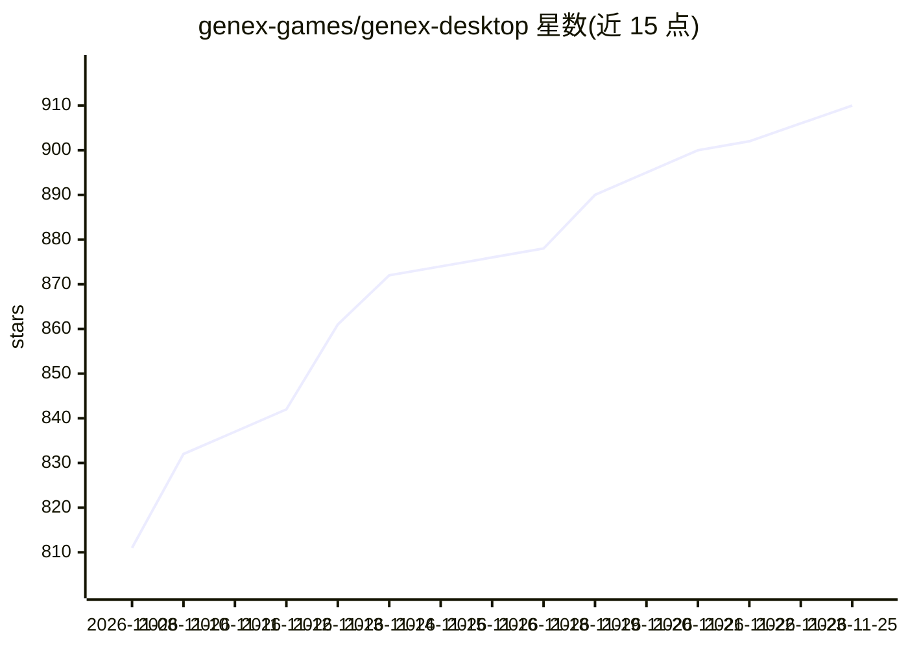

# genex-games/genex-desktop

⭐ 910 · TypeScript · MIT · 推送 2026-11-23 · [GitHub](https://github.com/genex-games/genex-desktop) · [官网](https://genex.games/desktop) · 组织维护

**AI 原生游戏开发的桌面应用：Agent 自动搭引擎、写游戏并试玩**

Genex 是一款开源桌面应用，让用户在 Unreal Engine、Unity、Godot、Roblox Studio 或 Three.js 中借助 AI Agent 进行游戏开发：Agent 负责设置引擎、构建游戏并自主试玩。支持接入 Claude Code、Codex、Cursor、OpenRouter 等云端 AI，也可用 Ollama、LM Studio、llama.cpp 本地模型；支持多 Agent 混合不同模型。内置 Genex Tools 统一调用 Tripo、Meshy、ElevenLabs 等资产生成工具，支持插件系统与 Marketplace 分发。提供 macOS/Linux/Windows 安装包，MIT 许可，README 自述产品尚处早期。

## 筛选速览

| 维度 | 判定 | 备注 |
|---|---|---|
| AI 角色 | `ai-native` | 本体是模型或模型工具 |
| 许可风险 | `permissive` | MIT |
| 部署形态 | `desktop` | 安装包/桌面程序 |
| 模型依赖 | local-ok | 支持本地模型 |
| 硬件要求 | — | 无带数字的原话,不猜 |
| 安装摩擦 | `low` | 无编译、无系统依赖或容器化 |
| 成熟度 | `idea` | |

## 能力要点

- 支持五大引擎：Unreal、Unity、Godot、Roblox、Three.js
- 云端与本地模型均可接入：Claude Code、Codex、OpenRouter 或 Ollama、LM Studio、llama.cpp
- 内置 Genex Tools：经一个 CLI/MCP server 路由到 Tripo、Meshy、ElevenLabs 等资产生成工具
- 插件系统：本地加载或从 GitHub 安装，经 Marketplace 分发

## 适用场景

- 用 AI Agent 自动搭建游戏项目并自行试玩迭代
- 在无云端 API 的环境下用本地模型做 AI 辅助游戏开发
- 一句话生成服务器权威的多人与Web发布

## 场景标签

`编码 Agent` `多智能体` · 领域:Agent 开发

## 证据(README 行号)

> L8:  Open-source desktop app for AI-native game dev. Agents set up the engine, build your game and play-test it by thems
> L14:  Genex, a desktop app for game dev with AI: Unreal Engine, Unity, Godot, Roblox and Three.js, with built-in game de
> L31: → Or local models: Ollama, LM Studio, llama.cpp\

## 星数曲线

2026-11-08 811 → 2026-11-25 910（+99）

---
*卡片 v1 · prompt 1.4 · 生成 2026-11-24 · 置信度 high · 依据 README sha `7b105bc72546` · [字段定义](../../DATASET.md)*
