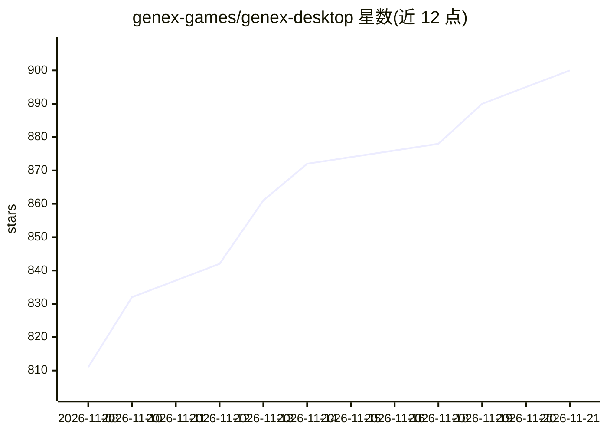

# genex-games/genex-desktop

⭐ 900 · TypeScript · MIT · 推送 2026-11-20 · [GitHub](https://github.com/genex-games/genex-desktop) · [官网](https://genex.games/desktop) · 组织维护

**AI 游戏开发桌面应用：用 agent 搭建引擎、构建并试玩游戏**

Genex 是面向游戏开发者的桌面应用：用户通过对话让 agent 在 Unreal Engine、Unity、Godot、Roblox Studio 或浏览器中制作游戏，agent 负责引擎设置、构建与自动试玩。模型接入支持 Claude Code/ChatGPT 订阅或本地模型，可跨主 agent、工作者与审阅者混用多模型。内置 Blender 本地 3D 资产生成插件，并通过工具路由接入 Meshy、Tripo、ElevenLabs 等服务；支持插件开发与 Marketplace 分发。提供 macOS/Linux/Windows 安装包，README 自述处于早期阶段。

## 筛选速览

| 维度 | 判定 | 备注 |
|---|---|---|
| AI 角色 | `ai-native` | 本体是模型或模型工具 |
| 许可风险 | `permissive` | MIT |
| 部署形态 | `desktop` | 安装包/桌面程序 |
| 模型依赖 | locked-api |  |
| 硬件要求 | — | 无带数字的原话,不猜 |
| 安装摩擦 | `low` | 无编译、无系统依赖或容器化 |
| 成熟度 | `idea` | |

## 能力要点

- agent 自动设置引擎、构建并试玩游戏（Unreal/Unity/Godot/Roblox/浏览器）
- 支持 Claude Code/ChatGPT 订阅或本地模型，多 agent 混用不同模型
- Blender 插件本地生成 3D 资产，工具路由接入 Meshy/Tripo/ElevenLabs
- 插件体系与 Genex Marketplace 分发

## 适用场景

- 用对话方式在主流游戏引擎中开发游戏
- 让 agent 自动搭建引擎环境并试玩游戏
- 本地生成 3D 资产或调用外部资产生成服务

## 场景标签

`编码 Agent` `多智能体` · 领域:Agent 开发

## 证据(README 行号)

> L7:  Desktop app for game dev with AI: make games in Unreal Engine, Unity, Godot or the browser. The agent sets up the e
> L34: → Build in Unreal Engine, Unity, Godot or Roblox Studio: the agent sets up the engine and play-tests the game\

## 星数曲线

2026-11-08 811 → 2026-11-21 900（+89）

---
*卡片 v1 · prompt 1.4 · 生成 2026-11-17 · 置信度 high · 依据 README sha `b068979acb06` · [字段定义](../../DATASET.md)*
