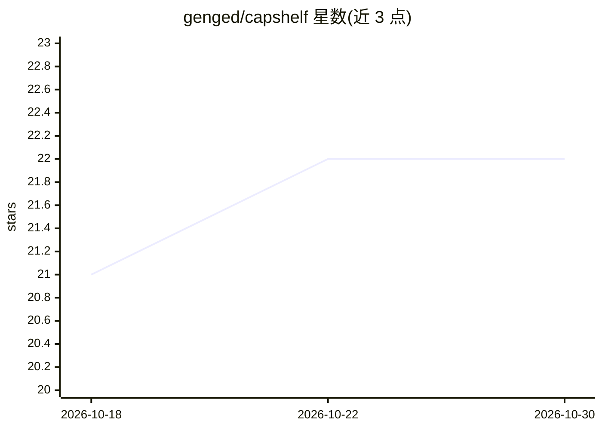

# genged/capshelf

⭐ 22 · TypeScript · MIT · 推送 2026-10-22 · [GitHub](https://github.com/genged/capshelf) · [官网](https://github.com/genged/capshelf) · 个人维护

**跨仓库共享 AI agent 技能、配置与 MCP 的版本管理 CLI**

面向使用 Claude Code、Codex CLI 与 Pi 的开发者的配置共享工具：将技能、插件、子代理、settings 与 MCP 片段集中在一个 Git 数据仓库（shelf），各项目通过 lock 固定所用版本；本地编辑经 promote 提交回数据仓库，其他项目保持原版本直到运行 update。支持三方合并、依赖/冲突声明、CI drift 检查（--strict 退出码 4）、从任意 Git 仓库安装技能（含许可检查）及 bundle 安装。无账号、无托管服务、不自动 push。

## 筛选速览

| 维度 | 判定 | 备注 |
|---|---|---|
| AI 角色 | `ai-ecosystem` | LLM/agent 周边工具 |
| 许可风险 | `permissive` | MIT |
| 部署形态 | `None` |  |
| 模型依赖 | — | README 未给出锁定关系 |
| 硬件要求 | — | 无带数字的原话,不猜 |
| 安装摩擦 | `medium` | 含编译或系统依赖之一 |
| 成熟度 | — | 结构信号不足 |

## 能力要点

- per-project lock 固定版本，promote/update 分离各项目变更
- update --merge 三方合并，冲突不改动文件
- CI 中 status --strict 检测 drift（退出码 4）
- 从任意 Git 仓库安装技能与 Claude Code 插件，含许可与命令提示

## 适用场景

- 团队将共享 agent 技能与 MCP 配置统一到一个 Git 仓库并经 PR 审查
- 多项目各自固定共享技能版本，避免手动复制漂移
- 让 agent 按自然语言指令执行 share/promote/update 操作

## 场景标签

 · 领域:AI agent 配置管理/开发者工具

## 证据(README 行号)

> L4:  Share agent skills and config across your repos. Pin a version per project.
> L5:  Works with Claude Code, Codex CLI, and Pi.
> L15: Keep your skills, subagents, settings, and MCP servers in one Git repo. Each

## 星数曲线

2026-10-18 21 → 2026-10-30 22（+1）

---
*卡片 v1 · prompt 1.4 · 生成 2026-10-27 · 置信度 high · 依据 README sha `1d44f11d6441` · [字段定义](../../DATASET.md)*
