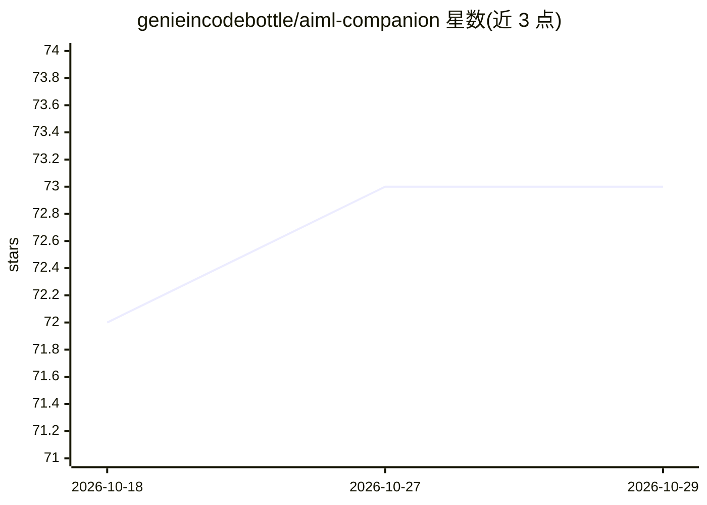

# genieincodebottle/aiml-companion

⭐ 73 · Jupyter Notebook · 推送 2026-10-19 · [GitHub](https://github.com/genieincodebottle/aiml-companion) · [官网](https://aimlcompanion.ai) · 个人维护

**AI/ML 交互式学习平台及 24 个端到端配套项目仓库**

AI-ML Companion 是通过实时动画可视化和浏览器内可运行 Python 代码教授 AI/ML 的交互式学习平台：28 条学习路径、400+ 模块，覆盖数学基础到深度学习、LLM、Agentic AI、MLOps 与云端 GenAI，提供英/印地/西三语讲解与 PWA 离线安装。本仓库收录 24 个端到端配套项目，从经典 ML、CV 到多 Agent 系统与生产 LLM，多数按行业最佳实践结构组织，含大量测试与交互式讲解。免费层含 8 条完整路径，Premium 解锁全部内容。

## 筛选速览

| 维度 | 判定 | 备注 |
|---|---|---|
| AI 角色 | `ai-knowledge` | 知识聚合/清单类 |
| 许可风险 | `none` | — |
| 部署形态 | `library` | 以包/库形式分发 |
| 模型依赖 | — | README 未给出锁定关系 |
| 硬件要求 | — | 无带数字的原话,不猜 |
| 安装摩擦 | `low` | 无编译、无系统依赖或容器化 |
| 成熟度 | — | 结构信号不足 |

## 能力要点

- 28 条路径、400+ 模块，实时可视化加浏览器内可运行 Python
- 24 个端到端项目，覆盖经典 ML、CV、DL、LLM、多 Agent、MLOps、数据工程
- 英/印地/西班牙语三语讲解，技术术语保留英文
- PWA 形式，手机与桌面可安装、可离线使用

## 适用场景

- 初学者以直觉优先的方式入门 AI/ML
- 工程师转向 ML/MLOps/LLM/Agentic AI 岗位时系统学习
- 准备 AI/ML 面试时查阅 Interview Q&A 路径
- 跟随 24 个项目练习从建模到部署的完整流程

## 场景标签

`教程课程` · 领域:学习与行业

## 证据(README 行号)

> L16: These 24 projects are the hands-on companion to **AI-ML Companion**, an interactive platform for learning AI and ma
> L18: - **28 tracks, 400+ modules** from Python and math foundations to deep learning, LLMs, agentic AI, MLOps, and cloud

## 星数曲线

2026-10-18 72 → 2026-10-29 73（+1）

---
*卡片 v1 · prompt 1.4 · 生成 2026-10-24 · 置信度 mid · 依据 README sha `b401e4e12aae` · [字段定义](../../DATASET.md)*
