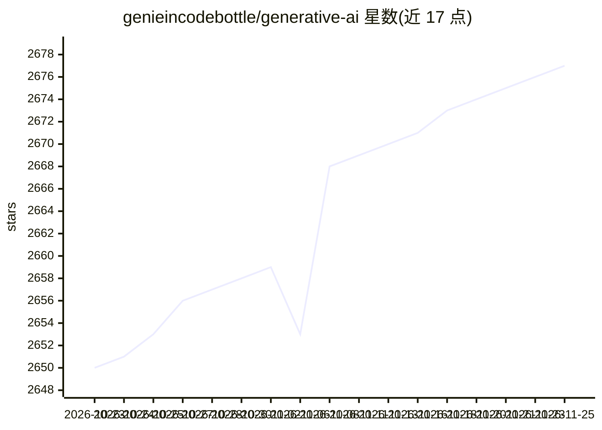

# genieincodebottle/generative-ai

⭐ 2,677 · Jupyter Notebook · MIT · 推送 2026-11-21 · [GitHub](https://github.com/genieincodebottle/generative-ai) · [官网](https://aimlcompanion.ai/) · 个人维护

**GenAI 学习资源库：路线图、用例项目与面试/编码准备**

面向生成式 AI 学习者的资源聚合仓库：提供 GenAI 与 AI/ML 学习路线图、向量嵌入/Prompt 工程/RAG 架构等核心概念资料、AWS/Azure/VertexAI 云平台实施指南、面向 ML/GenAI/Agent 岗位的面试 Q&A 系列，以及高级 RAG、多 Agent 系统、Text-to-SQL、情感分析等实践项目索引。仓库本体是资料与项目链接的集合，安装仅涉及 git clone；部分面试模块分免费预览与 Pro 付费内容。

## 筛选速览

| 维度 | 判定 | 备注 |
|---|---|---|
| AI 角色 | `ai-knowledge` | 知识聚合/清单类 |
| 许可风险 | `permissive` | MIT |
| 部署形态 | `None` |  |
| 模型依赖 | — | README 未给出锁定关系 |
| 硬件要求 | — | 无带数字的原话,不猜 |
| 安装摩擦 | `low` | 无编译、无系统依赖或容器化 |
| 成熟度 | — | 结构信号不足 |

## 能力要点

- GenAI 与 AI/ML 交互式学习路线图（markdown/PDF）
- 20 个面试 Q&A 模块，覆盖 ML、GenAI 与 Agentic AI
- 高级 RAG 与多 Agent（CrewAI/LangGraph）实践项目索引
- AWS/Azure/VertexAI 三大云平台的 GenAI 实施指南

## 适用场景

- 按路线图系统学习生成式 AI 与 LLM 应用开发
- 准备 ML/GenAI/Agent 方向的面试问答与系统设计
- 查找 RAG、多 Agent、Text-to-SQL 等可动手的项目案例
- 了解 OpenAI/Gemini/Claude/Groq 与本地模型等 LLM 提供商对比

## 场景标签

`教程课程` · 领域:学习与行业

## 证据(README 行号)

> L21: Your go-to hub for end-to-end GenAI learning. ⭐ Star this repo to stay updated with the latest GenAI resources :)
> L24: - Documentation & Learning Resources
> L30: - **AI-ML Companion** - Interactive AI/ML learning platform with 28 tracks, 400+ modules, visualizations, quizzes, 

## 星数曲线

2026-10-23 2,650 → 2026-11-25 2,677（+27）

---
*卡片 v1 · prompt 1.4 · 生成 2026-11-23 · 置信度 high · 依据 README sha `a6d866ad9288` · [字段定义](../../DATASET.md)*
