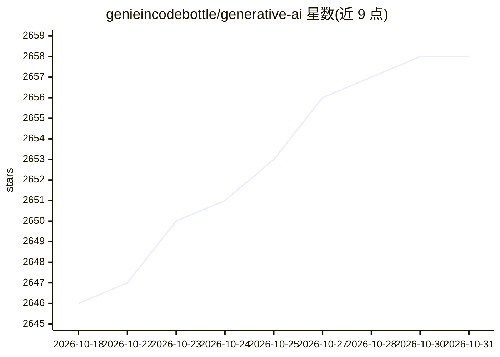

# genieincodebottle/generative-ai

⭐ 2,658 · Jupyter Notebook · MIT · 推送 2026-10-26 · [GitHub](https://github.com/genieincodebottle/generative-ai) · [官网](https://aimlcompanion.ai/) · 个人维护

**生成式 AI 学习资源与项目合集（路线图、面试题、实战项目）**

面向学习者的生成式 AI 资源聚合仓库：收录 GenAI 学习路线图、AI/ML 核心概念文档、云平台（AWS/Azure/VertexAI）实施指南、面试问答（GenAI/RAG/Agentic AI/ML 系统设计等 20 个模块）以及实战项目清单（Advanced RAG、Agentic AI 多智能体、Text-to-SQL、Prompt Guard 等）。同时推广作者维护的交互式学习平台 AI-ML Companion（28 轨道 400+ 模块，部分内容需 Pro）。仓库本身以文档与链接为主，通过 fork/clone 贡献资源。

## 筛选速览

| 维度 | 判定 | 备注 |
|---|---|---|
| AI 角色 | `ai-knowledge` | 知识聚合/清单类 |
| 许可风险 | `permissive` | MIT |
| 部署形态 | `None` |  |
| 模型依赖 | — | README 未给出锁定关系 |
| 硬件要求 | — | 无带数字的原话,不猜 |
| 安装摩擦 | `low` | 无编译、无系统依赖或容器化 |
| 成熟度 | — | 结构信号不足 |

## 能力要点

- GenAI/AI-ML 学习路线图与核心概念文档（PDF/notebook）
- 覆盖 GenAI、RAG、Agentic AI、ML 系统设计的面试问答模块
- 实战项目清单：Advanced RAG、多智能体、Text-to-SQL、Prompt Guard 等
- AWS/Azure/VertexAI 三大云平台的 GenAI 实施指南

## 适用场景

- 按路线图系统学习 GenAI 与 ML 相关技术
- 准备 GenAI/Agentic AI/ML 方向的面试
- 查找 RAG、多智能体等方向的实战项目参考

## 场景标签

`教程课程` `精选清单` · 领域:学习与行业

## 证据(README 行号)

> L21: Your go-to hub for end-to-end GenAI learning. ⭐ Star this repo to stay updated with the latest GenAI resources :)
> L27: ## 📖 Documentation & Learning Resources

## 星数曲线

2026-10-18 2,646 → 2026-10-31 2,658（+12）

---
*卡片 v1 · prompt 1.4 · 生成 2026-10-21 · 置信度 high · 依据 README sha `8a2dd4e37561` · [字段定义](../../DATASET.md)*
