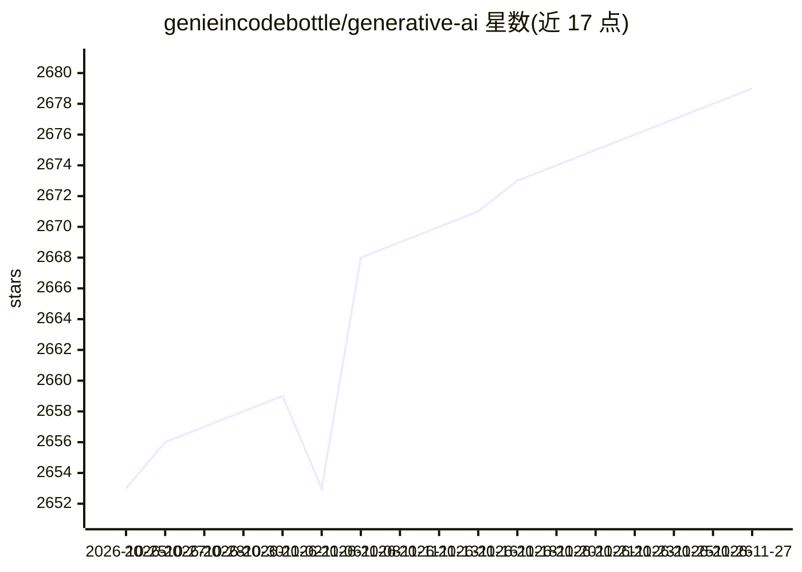

# genieincodebottle/generative-ai

⭐ 2,679 · Jupyter Notebook · MIT · 推送 2026-11-25 · [GitHub](https://github.com/genieincodebottle/generative-ai) · [官网](https://aimlcompanion.ai/) · 组织维护

**GenAI 学习资源库：路线图、用例、面试与编码准备**

聚合生成式 AI 学习与实践资源的仓库：提供 GenAI 与 AI/ML 学习路线图（交互式/PDF）、向量嵌入与提示工程等核心概念文档、AWS/Azure/VertexAI 云平台指南、面向 ML/GenAI/Agentic AI 岗位的面试问答（20 个模块）与 ML 系统设计材料，以及 RAG、多智能体、聊天机器人、Text-to-SQL 等用例项目链接。仅 git clone 说明面向贡献者，资源以外部链接为主。

## 筛选速览

| 维度 | 判定 | 备注 |
|---|---|---|
| AI 角色 | `ai-knowledge` | 知识聚合/清单类 |
| 许可风险 | `permissive` | MIT |
| 部署形态 | `None` |  |
| 模型依赖 | — | README 未给出锁定关系 |
| 硬件要求 | — | 无带数字的原话,不猜 |
| 安装摩擦 | `low` | 无编译、无系统依赖或容器化 |
| 成熟度 | — | 结构信号不足 |

## 能力要点

- GenAI 学习路线图与 AI 设计模式文档
- ML/GenAI/Agentic AI 面试问答与系统设计准备
- RAG、多智能体、Text-to-SQL 等用例项目合集
- AWS/Azure/VertexAI 三大云平台 GenAI 实现指南

## 适用场景

- 规划 GenAI 从入门到生产的学习路径
- 准备 ML/GenAI/Agentic AI 岗位面试
- 查找 RAG、多智能体等方向的实践项目参考

## 场景标签

`精选清单` `教程课程` · 领域:学习与行业

## 证据(README 行号)

> L24: - Documentation & Learning Resources
> L30: - **AI-ML Companion** - Interactive AI/ML learning platform with 28 tracks, 400+ modules, visualizations, quizzes, 
> L53: **Interview Q&A track** - 20 always-current Q&A modules across ML, GenAI, and Agentic AI (free preview questions, f

## 星数曲线

2026-10-25 2,653 → 2026-11-27 2,679（+26）

---
*卡片 v1 · prompt 1.4 · 生成 2026-11-26 · 置信度 high · 依据 README sha `6d2338e3b588` · [字段定义](../../DATASET.md)*
