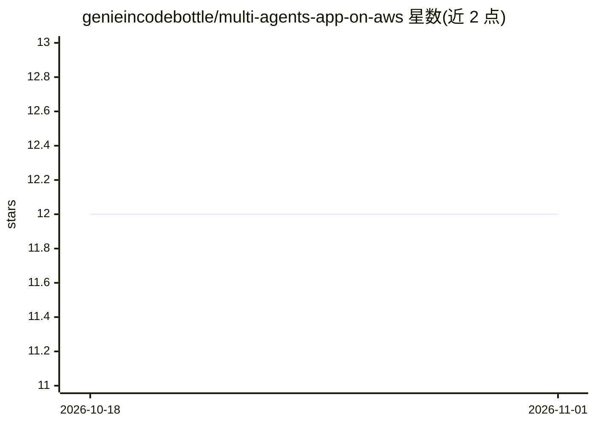

# genieincodebottle/multi-agents-app-on-aws

⭐ 12 · Python · MIT · 推送 2026-09-06 · [GitHub](https://github.com/genieincodebottle/multi-agents-app-on-aws) · [官网](https://www.instagram.com/genieincodebottle/) · 个人维护

**在 AWS 上构建多智能体研究写作系统的教学项目（4 协作 Agent）**

用约 600 行 Python 从零实现的多智能体系统：Orchestrator 分解任务并调度 Research/Analyst/Writer 三个专职 Agent，协作完成网络调研、数据分析与结构化报告撰写，刻意不使用 LangGraph/CrewAI 等框架以展示底层机制。分两阶段：本地以单进程运行（Groq/Gemini 免费 API），生产阶段部署到 AWS Bedrock AgentCore 的 serverless microVM，每个 Agent 独立隔离、经 A2A 协议通信并使用持久记忆。面向想理解多智能体内部原理并部署上 AWS 的开发者，MIT 许可。

## 筛选速览

| 维度 | 判定 | 备注 |
|---|---|---|
| AI 角色 | `ai-native` | 本体是模型或模型工具 |
| 许可风险 | `permissive` | MIT |
| 部署形态 | `desktop` | 安装包/桌面程序 |
| 模型依赖 | locked-api |  |
| 硬件要求 | — | 无带数字的原话,不猜 |
| 安装摩擦 | `low` | 无编译、无系统依赖或容器化 |
| 成熟度 | — | 结构信号不足 |

## 能力要点

- Orchestrator + Research/Analyst/Writer 四 Agent 协作产出研究报告
- 不依赖任何 agentic 框架，约 600 行 Python 展示编排/通信/上下文传递底层机制
- 支持 Groq/Gemini/AWS Bedrock 三种 LLM 提供商
- 可经脚本或 Terraform 部署到 Bedrock AgentCore（自动扩缩、持久记忆、A2A 协议）

## 适用场景

- 学习多智能体系统的编排与协作原始机制
- 本地免费搭建一个自动调研并写报告的 AI 团队
- 把多智能体系统部署到 AWS 生产环境（自动扩缩、多用户）

## 场景标签

`多智能体` `数据分析` `教程课程` · 领域:Agent 开发

## 证据(README 行号)

> L14: A multi-agent system where 4 AI agents collaborate to research any topic and produce a comprehensive report:
> L26: **What you get:** A structured report with sourced research, comparative analysis, and actionable recommendations -
> L56: |**What**|Run all agents on your laptop as a single Python process|Deploy each agent to AWS Bedrock AgentCore (serv

## 星数曲线

2026-10-18 12 → 2026-11-01 12（+0）

---
*卡片 v1 · prompt 1.4 · 生成 2026-11-01 · 置信度 high · 依据 README sha `a09e32d7ca5d` · [字段定义](../../DATASET.md)*
