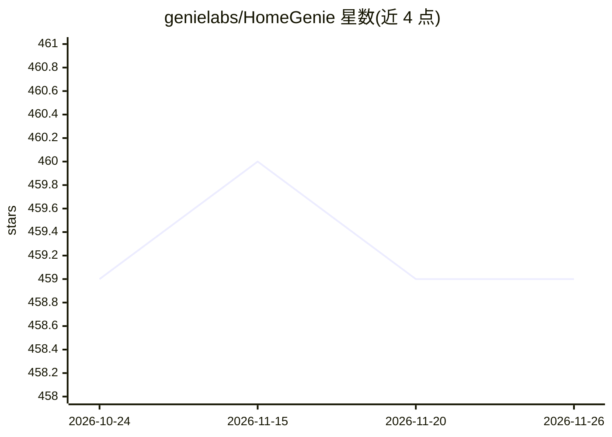

# genielabs/HomeGenie

⭐ 459 · JavaScript · AGPL-3.0 · 推送 2026-11-24 · [GitHub](https://github.com/genielabs/HomeGenie) · [官网](https://homegenie.it) · 组织维护

**本地优先的家庭自动化平台，内置本地 Agentic AI 与视觉套件**

开源、不依赖云端的家庭自动化生态系统，包含固件、后端服务与移动/平板应用。核心机制：可视化编辑器与 C#/JavaScript/Python 可编程 API 构建自动化；可本地运行 LLM 实现自主推理与自然语言设备控制；集成 YOLO 目标检测/实例分割/姿态估计，支持服务器端、ESP32-CAM 与 IP 摄像头；支持 X10、Z-Wave、ZigBee、GPIO 等多协议驱动；内置 Whisper 语音识别与 Piper 语音合成。限制：全新安装默认无密码，需手动配置；本地语音功能依赖 MIG.Audio 集成。

## 筛选速览

| 维度 | 判定 | 备注 |
|---|---|---|
| AI 角色 | `ai-enhanced` | 去掉 AI 部分产品仍成立 |
| 许可风险 | `viral` | AGPL-3.0 |
| 部署形态 | `desktop` | 安装包/桌面程序 |
| 模型依赖 | — | README 未给出锁定关系 |
| 硬件要求 | `cpu-ok` | |
| 安装摩擦 | `medium` | 含编译或系统依赖之一 |
| 成熟度 | — | 结构信号不足 |

## 能力要点

- 100% 本地运行 LLM，提供自主推理与自然语言控制
- YOLO 视觉套件：目标检测、实例分割、姿态估计
- 多协议驱动：X10、Z-Wave、ZigBee、GPIO、SPI、I2C、IR/RF
- UI 支持 90+ 语言，ZIP 解压即可运行

## 适用场景

- 在家中自托管智能家居中枢并保持数据本地化
- 用自然语言或可视化编辑器创建自动化场景
- 在树莓派上部署摄像头目标检测与语音控制

## 场景标签

`语音合成` `语音识别` `目标检测` · 领域:内容生成

## 证据(README 行号)

> L13: HomeGenie is an open-source, cloud-independent ecosystem for smart automation.
> L21: Create automations easily with the Visual Editor, or activate the built-in AI features
> L31: - **100% Local Agentic AI:** Run state-of-the-art LLMs directly on your HomeGenie

## 星数曲线

2026-10-24 459 → 2026-11-26 459（+0）

---
*卡片 v1 · prompt 1.4 · 生成 2026-11-25 · 置信度 high · 依据 README sha `28e30c2ae3b7` · [字段定义](../../DATASET.md)*
